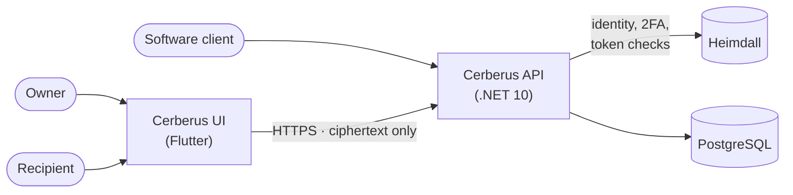

+++
title = 'Documentation'
linkTitle = 'Docs'
weight = 10
description = 'Everything about Cerberus: what it is, how it is built, how it works and how to run it.'
[menu.main]
  weight = 10
+++

Cerberus is an **end-to-end encrypted vault** for credentials, passwords, notes and any other
sensitive record. It is made of two applications and depends on one external service:

| Component | What it is | Repository |
| --- | --- | --- |
| **Cerberus API** | A .NET 10 web API that stores ciphertext and enforces ownership, sharing and lifecycle. It can never decrypt the vault. | [cerberus-api](https://git.techcraftsmen.net/artur-rios/cerberus-api) |
| **Cerberus UI** | A Flutter client for the web, Windows, Linux and Android — where the vault is actually opened. | [cerberus-ui](https://git.techcraftsmen.net/artur-rios/cerberus-ui) |
| **Heimdall** | The external identity service Cerberus delegates sign-in, second factor and identities to. | — |

{}
The **API** has its foundation and all 55 business use cases implemented. The **client** has its
foundation, sign-in with a second factor, session restore, sign-out, the route guard and
preferences; the rest is next. The Cerberus cryptographic protocol is **pending an independent
security review**, which is required before any release — see
[Security model](/docs/architecture/security-model/#review-status) and
[Roadmap](/docs/reference/roadmap/).
{}

## Where to start

- **New to Cerberus?** Read the [Introduction](/docs/introduction/) and the [Glossary](/docs/introduction/glossary/).
- **Want to run it?** Follow [Getting started](/docs/getting-started/).
- **Want to know how it works?** Start at [Architecture](/docs/architecture/), then the
  [Security model](/docs/architecture/security-model/), the [Domain model](/docs/concepts/domain-model/)
  and the [Flows](/docs/flows/).
- **Integrating with the API?** Go to the [REST API reference](/docs/reference/rest-api/) and
  [Responses and errors](/docs/reference/responses-and-errors/).
- **Operating an instance?** See [Operations](/docs/operations/).
- **Contributing?** See [Development](/docs/development/).
