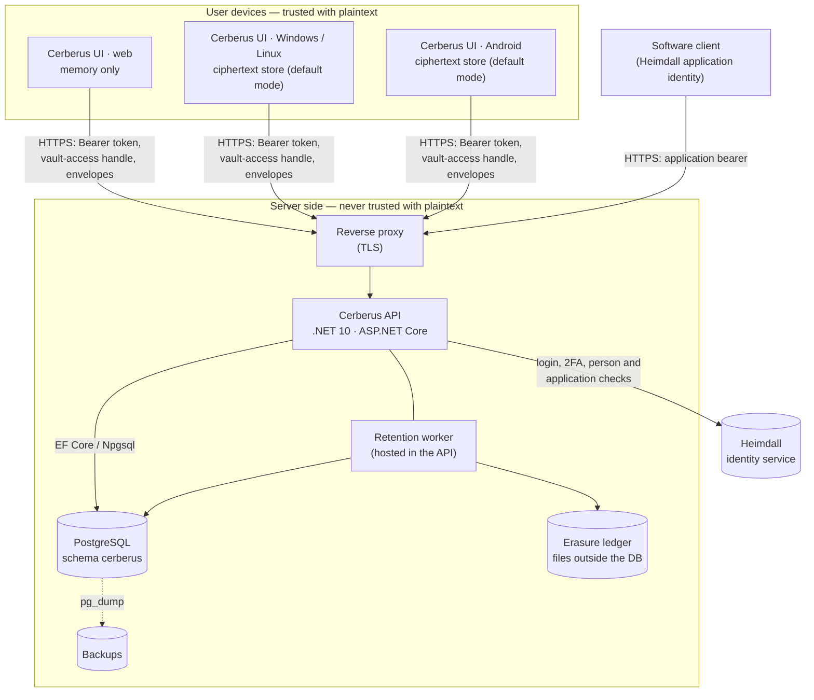
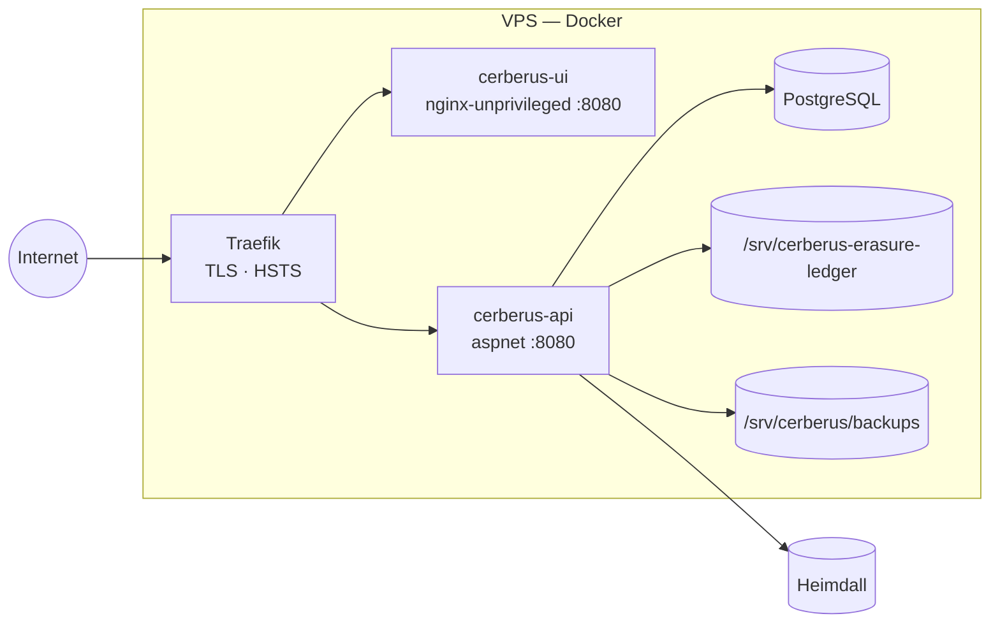

+++
title = 'Architecture'
linkTitle = 'Architecture'
weight = 30
description = 'The system as a whole: components, trust boundaries and deployment.'
+++

## System context

| Component | Responsibility | Never |
| --- | --- | --- |
| **Cerberus UI** | Derives keys, encrypts and decrypts, verifies envelopes and fingerprints, enforces local obligations (auto-lock, lease expiry, clipboard clearing). | Sends plaintext or usable keys; decides authorization. |
| **Cerberus API** | Stores ciphertext and opaque wrappers, enforces ownership, grants, revisions, lifecycle and retention; issues challenges, vault-access handles and offline leases. | Decrypts content or holds a usable decryption key. |
| **Heimdall** | Persons, applications, sign-in, second factor; issues the bearer tokens Cerberus validates. | Sees vault content. |
| **PostgreSQL** | Persistence for every Cerberus entity. | Holds anything a dump could decrypt. |
| **Erasure ledger** | Records completed erasures outside the restorable database, so a restore can reapply them. | Holds content — only id, kind and deletion time. |

## Trust boundaries

1. **The device boundary.** Plaintext and usable keys exist only inside the client process, in
   memory, and only while the vault is unlocked. What crosses this boundary is ciphertext, wrapped
   keys, public keys and proofs.
2. **The identity boundary.** Heimdall decides *who* the caller is. Cerberus validates every
   token on every protected request (signature, issuer, audience, expiry, scope) and checks the
   identity live with Heimdall; an unavailable Heimdall fails closed with `503 identity_unavailable`.
3. **The vault-access boundary.** Being signed in opens nothing. Content requests additionally need
   a vault-access handle that only a client holding the unlock key can obtain.

## Deployment

Both applications are shipped as containers and deployed through **yggdrasil**, the owner's
deployment platform, on an Ubuntu VPS under Docker behind **Traefik**, which terminates TLS. CI runs
on **Jenkins** — see [Continuous integration](/docs/development/continuous-integration/).

## In this section

- [API](api/) — the layered .NET solution, CQRS, persistence and the retention worker.
- [Client](client/) — the Flutter application's features, guard, storage and generated client.
- [Security model](security-model/) — keys, envelopes, proofs, leases and the protocol review.
