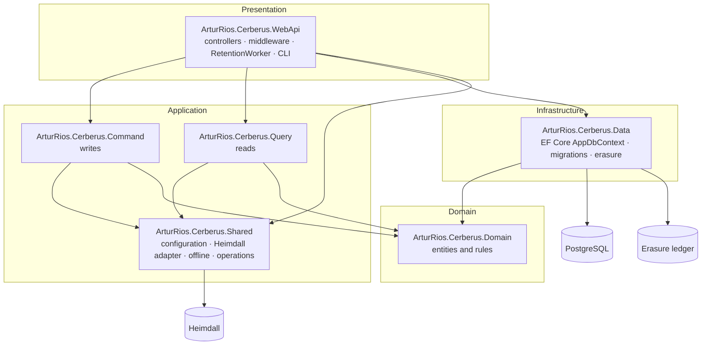
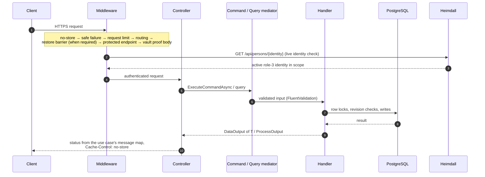
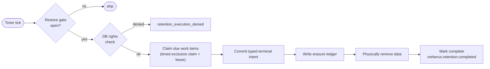

+++
title = 'API (Cerberus API)'
linkTitle = 'API'
weight = 20
description = 'How the .NET solution is layered: Domain, CQRS Application projects, EF Core persistence, the Web API host and the retention worker.'
+++

The Cerberus API is an ASP.NET Core web API on **.NET 10**, organized in layers with a
**command/query split** (CQRS) dispatched through a mediator. It is written so that the server can
enforce everything about a vault — ownership, grants, revisions, lifecycle, retention — except
reading it.

## Solution layout

The solution is `src/ArturRios.Cerberus.sln`:

| Project | Holds |
| --- | --- |
| `src/Domain/ArturRios.Cerberus.Domain` | Entities and rules, by area: Access, Accounts, Collections, Folders, Identity, Offline, Operations, Profiles, Protection, Records, Resources, Software, Sync, Trash. |
| `src/Application/ArturRios.Cerberus.Command` | Command handlers (writes), by area: Accounts, Authentication, Collections, Folders, Identity, Offline, Profiles, Protection, Records, Software, Sync, Trash. |
| `src/Application/ArturRios.Cerberus.Query` | Query handlers (reads), for the same areas minus Authentication and Identity. |
| `src/Application/ArturRios.Cerberus.Shared` | Configuration and its validator, the Heimdall adapter, offline lease signing, operations. |
| `src/Infrastructure/ArturRios.Cerberus.Data` | The EF Core `AppDbContext`, migrations and erasure. |
| `src/Presentation/ArturRios.Cerberus.WebApi` | Controllers, middleware, the hosted `RetentionWorker`, operational commands and the configuration binding. |

## Request pipeline

- **Middleware**, in registration order: `NoStoreMiddleware` (every response carries
  `Cache-Control: no-store`), `SafeFailureMiddleware` (no internal detail leaks), 
  `RequestLimitMiddleware` (bodies over `CERBERUS_MAX_REQUEST_BYTES` are refused), routing,
  `RestoreBarrierMiddleware` (only when `CERBERUS_RESTORE_REQUIRED` is set),
  `ProtectedEndpointMiddleware` and `VaultProofBodyMiddleware` (keeps the exact request bytes a
  proof is bound to).
- **Controllers** (one per area): Account, AccountExport, Auth, Collections, Folders, Health,
  Identity, OfflineAuthorizations, Profiles, Records, SoftwareGrants, SoftwareSecrets, Sync, Trash
  and Vault.
- **Mediator**: controllers inject `CommandMediator` and `QueryMediator` (from
  `ArturRios.Mediator`) and call `ExecuteCommandAsync<TCommand, TOutput>(…)`.
- **Results**: handlers return `DataOutput<T>` or `ProcessOutput` (from `ArturRios.Output`), and
  `ToActionResult(statusMap: …)` turns each use case's canonical messages into HTTP status codes.
  See [Responses and errors](/docs/reference/responses-and-errors/).
- **The actor** is read from the token's `id` claim; `iat` and `exp` are read too (`iat` backs the
  *fresh authentication* rule: a token signed less than 60 seconds ago).

## Persistence

- **EF Core with Npgsql**, PostgreSQL only, default schema `cerberus`, singular snake_case names
  (`UseSnakeCaseNamingConvention()`), sensitive-data logging and detailed errors disabled.
- **Two identifiers per row**: an internal `bigint` key that is never exposed, and a public GUID.
  Public ids of offline-created items are generated by the client, and a deleted id stays reserved
  forever.
- **A global sequence**, `cerberus.server_sequence`, orders every change for synchronization.
- **Concurrency**: optimistic revisions on every write (`expectedRevision`), plus PostgreSQL row
  locks taken in one canonical order — account → session → profile → collections → grants →
  folders → records — and statement-time checks in the database.

Migrations, in order: `Foundation`, `TerminalErasure`, `AccountRegistration`,
`VaultAccessSessions`, `VaultProtectionAndChallenges`, `VaultRecoveryOperations`, `Profiles`,
`ProfileTrash`, `ProfileAssociations`, `CollectionMembership`, `TypedTerminalErasure`,
`SoftwareGrants`, `DurableProfileSynchronization`, `RetainedSyncVisibility`, `DurableSyncOperations`.

## Heimdall integration

| Need | Heimdall call |
| --- | --- |
| Sign-in | `POST /api/auth/login` (email, password, the configured scope) |
| Second factor | `POST /api/auth/2fa/verify` (challenge plus code or recovery code) |
| Registration | `POST /api/scopes/{scope}/persons` with a narrow scope-owner service token |
| Every protected request | `GET /api/persons/{identity}` with the user's token: an active role-3 identity in the configured scope |
| Software secrets | `GET /api/applications/self` with the application's token, on every read |
| Restore check | The scope and the service person, with the service credential |

- Tokens are HS256 JWTs. Cerberus validates signature, issuer, audience, expiry, scope and a
  non-empty identity GUID. Key rotation uses `CERBERUS_AUTH_VALIDATION_SECRET` and an optional
  `CERBERUS_AUTH_VALIDATION_SECRET_PREVIOUS`.
- Application tokens are issued by Heimdall (`POST /api/applications/token`), never by Cerberus.
  They must carry `tokenKind=application` and the distinct `CERBERUS_AUTH_APPLICATION_AUDIENCE`, with
  zero clock skew, and are accepted **only** by `GET /api/software-secrets`.
- The Heimdall client fails closed on unknown, oversized, malformed, timed-out or rejected
  responses; follows no redirects; bounds the whole response to 10 seconds; and logs no request or
  response.

## The retention worker

`RetentionWorker` is a hosted `BackgroundService` on a `PeriodicTimer` every
`CERBERUS_RETENTION_INTERVAL`. It is skipped while the restore gate is closed.

- Work items are keyed `trash/{operationId}`, `trash-erase/…`, `record-purge/{id}`,
  `account-purge/{accountId}` and `account-erase/{id}`; it also cleans up expired sync streams.
- Execution is **at least once** with idempotent handlers. No database transaction spans file I/O,
  and the ledger is always written before data is removed.
- Deadlines are checked at request time against database time, so a worker outage never extends a
  deadline.
- Metrics: meter `ArturRios.Cerberus.Retention`, counters `cerberus.retention.completed`,
  `.failures`, `.scheduled` and `.expired_streams`.
