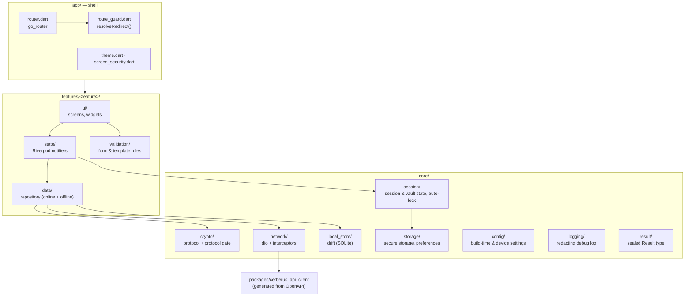
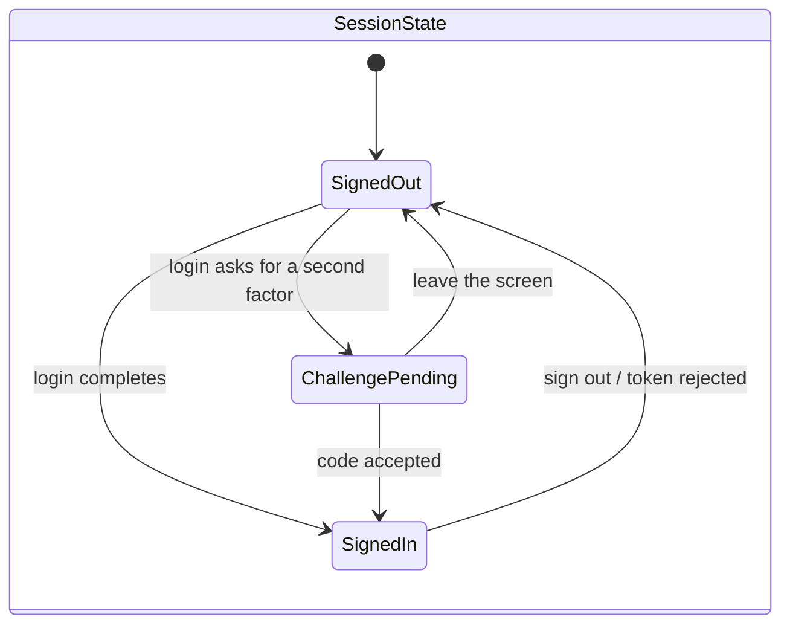
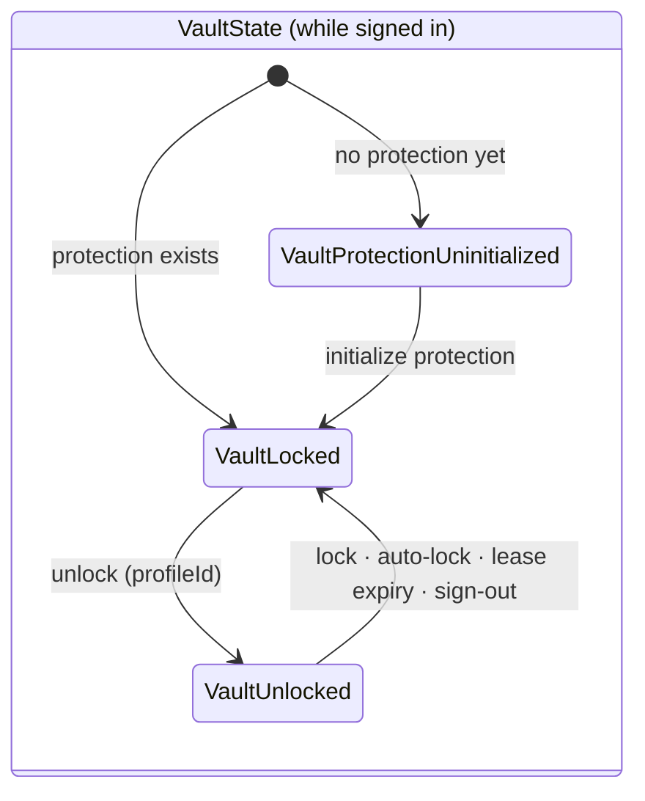
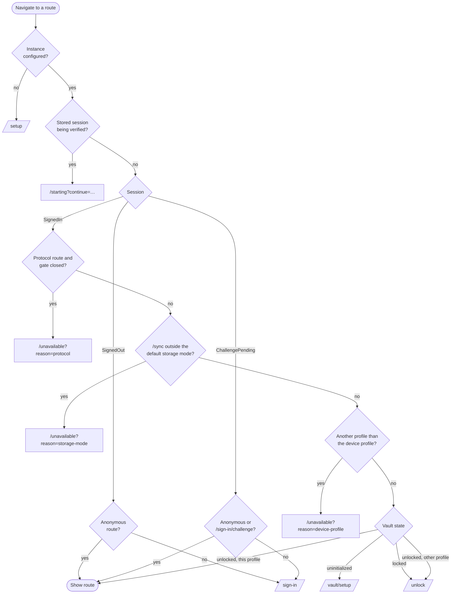
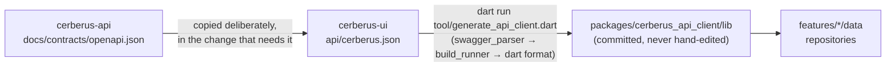
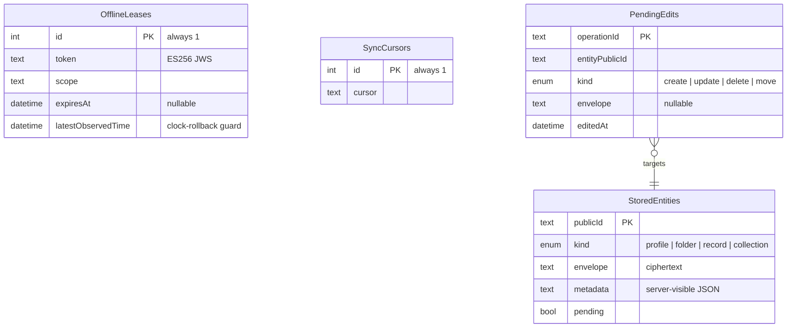

+++
title = 'Client (Cerberus UI)'
linkTitle = 'Client'
weight = 30
description = 'How the Flutter client is organized: features, the route guard, the crypto boundary, storage per target and the generated API client.'
+++

Cerberus UI is a single Flutter application for the **web, Windows, Linux and Android**. It is
where the vault is actually opened: it derives keys from the user's passwords, encrypts before
anything leaves the device and decrypts only what the user is looking at. iOS and macOS are not
supported, deliberately.

The repository holds two Dart packages: the application in `lib/`, and the generated HTTP client
in `packages/cerberus_api_client/`. It has no server component of its own, and it talks to nothing
but the Cerberus API — not Heimdall, not an analytics service, not a crash reporter.

## Layout

The application is organized **by feature**. A feature depends on `core`, never on another
feature, and features reach the network and the local store only through their repositories.



| Folder | Holds |
| --- | --- |
| `app/` | The shell: `cerberus_app.dart`, `router.dart`, `routes.dart`, `route_guard.dart`, `screen_security.dart`, `theme.dart`. |
| `core/config/` | Build-time configuration and device settings: `app_config.dart`, `instance_address.dart`, `instance_config.dart`, `device_settings.dart`, `preferences.dart`. |
| `core/crypto/` | The Cerberus protocol and the protocol gate (`protocol_gate.dart`). |
| `core/local_store/` | The drift schema, migrations, outbox, cursor and lease. |
| `core/logging/` | `AppLog`, the debug-only, redacting log. |
| `core/network/` | The single configured `dio` instance and its interceptors. |
| `core/result/` | The sealed result type every repository returns. |
| `core/session/` | Session state, vault lock state and auto-lock. |
| `core/storage/` | Secure storage and preference wrappers, one implementation per target. |
| `features/<feature>/` | `data/`, `state/`, `validation/` and `ui/` for one feature. |
| `l10n/` | ARB files and the generated `AppLocalizations`. |
| `shared/widgets/` | Shared screens: not found, not available, pending feature, message. |

A boundary check, `dart run tool/check_boundaries.dart`, fails the build if:

- a cryptographic package is imported outside `core/crypto`;
- a storage package is imported outside `core/storage` or `core/local_store`;
- `dio` or the local store is used outside a repository;
- a feature imports another feature;
- a browser-storage or observing (analytics, crash-reporting) package appears anywhere.

## State and dependency injection

[Riverpod](https://riverpod.dev/) (`flutter_riverpod`) is both the dependency-injection and the
state mechanism: providers are the only global wiring, and each feature owns its own. Models are
Dart sealed classes, so every `switch` over them is exhaustive.





## Start-up

`main.dart` starts in a fixed order:

1. Enable screen security (Android `FLAG_SECURE`, through the app's own method channel).
2. Restore the instance configuration, device settings and preferences.
3. Start session restore — deliberately **not** awaited, so the neutral `/starting` screen shows meanwhile.
4. `runApp` with an `UncontrolledProviderScope`.

## Routing and the route guard

Routing uses [go_router](https://pub.dev/packages/go_router), which gives the web target real
URLs. One central, pure function — `resolveRedirect(GuardState, Uri)` in `app/route_guard.dart` —
decides every redirect. The router listens to the instance configuration, session, vault state,
device settings, protocol gate and session-restore providers, so a change to any of them
re-evaluates the current route at once.



- Routes are classified as `anonymous`, `challenge`, `signedIn` or `unlocked`. Only `/setup`,
  `/register` and `/sign-in` are anonymous; an unknown path is treated as needing a session and
  renders the not-found screen.
- The requested route travels in a `continue` query parameter and is followed only if it is an
  in-app path (no scheme, no authority, no `//`). Interstitial routes — `/starting`, `/sign-in`,
  `/sign-in/challenge`, `/vault/setup`, `/unlock`, `/recover` — are never remembered.

### Screen map

| Area | Routes |
| --- | --- |
| Configuration and identity | `/setup`, `/register`, `/sign-in`, `/sign-in/challenge`, `/closure/cancel` |
| Unlock | `/vault/setup`, `/unlock`, `/recover` |
| Vault (unlocked) | `/`, `/records/new`, `/records/:id`, `/records/:id/edit`, `/folders/:id`, `/collections`, `/collections/:id`, `/collections/:id/share`, `/shared`, `/profiles`, `/profiles/:id`, `/software-access`, `/trash`, `/sync` |
| Settings | `/settings`, `/settings/device`, `/settings/account`, `/settings/security`, `/settings/offline`, `/settings/privacy` |
| Code-only | `/starting`, `/unavailable?reason=protocol\|storage-mode\|device-profile` |

## The crypto boundary and the protocol gate

Only `core/crypto` may import a cryptographic package. No primitive is implemented by hand,
randomness comes only from the platform's secure generator, and key derivation runs off the UI
isolate.

The **protocol gate** is one constant in `lib/core/crypto/protocol_gate.dart`:

```dart
const String? approvedProtocolVersion = null;
```

While it is `null` the gate is **closed**: the Cerberus protocol is proposed, not yet approved by
its independent review (see [Security model](/docs/architecture/security-model/)). Every use case
that encrypts, decrypts, wraps or proves has no entry point, and its routes go to
`/unavailable?reason=protocol`. The constant changes only in the pull request that adopts an
approved protocol, which also adds the reviewed interoperability vectors to `test/vectors/` and
pins the cryptography libraries. `dart run tool/check_protocol_gate.dart` fails any build whose
gate is open without those vectors and a test that runs them.

## Network and the generated API client

The HTTP client is generated from the API's OpenAPI contract by
[swagger_parser](https://pub.dev/packages/swagger_parser) (retrofit + json_serializable):



- Unknown enum values decode to a sentinel instead of failing (`unknown_enum_value: true`).
- One `dio` instance: connect timeout 10 s, send and receive 30 s, `Accept: application/json`,
  and a bearer-token interceptor that puts the token in the `Authorization` header — never in a
  URL. There is no cache interceptor, ever, and nothing is retried.
- Only a `401 authentication_required` on a request that carried a token ends the session. A
  `401 vault_access_required`, or a 401 on a credential submission, does not.

## Storage per target

| Target | Secure storage | Preferences | Local store |
| --- | --- | --- | --- |
| Windows, Linux, Android | `flutter_secure_storage` (Windows DPAPI, Linux libsecret, Android Keystore) | `shared_preferences` | drift (SQLite), default storage mode only |
| Web | In memory only | In memory only | Not compiled in |

The web implementations are chosen by conditional import, so the web build contains no
browser-storage code at all: no local storage, session storage, IndexedDB, app cookies, Cache API
or service worker. Reloading the web app signs the user out.

The local store holds **only what the server already holds** — envelopes, server-visible
metadata, the protection bundle, the offline lease, the sync cursor and pending edits — so it has
no second encryption layer. Unlocked keys and decrypted items live in memory only, everywhere.



## Logging and device hygiene

- `AppLog` writes through `developer.log` in **debug builds only**; release and profile builds
  write nothing. Events are a fixed name plus fields, and a field is replaced by `[redacted]` when
  its name contains any of `authorization`, `body`, `ciphertext`, `code`, `credential`,
  `envelope`, `key`, `nonce`, `password`, `plaintext`, `recovery`, `secret`, `tag` or `token`.
- Android sets `FLAG_SECURE`, so content is excluded from screenshots and the recent-apps
  preview, and the app's data is excluded from backup.
- Roboto is bundled, so the web build fetches no font from a third party.
- The theme is Material 3, with light and dark schemes from one seed colour; en-US is the only
  locale at the first release, and no user-facing string is hard-coded.
