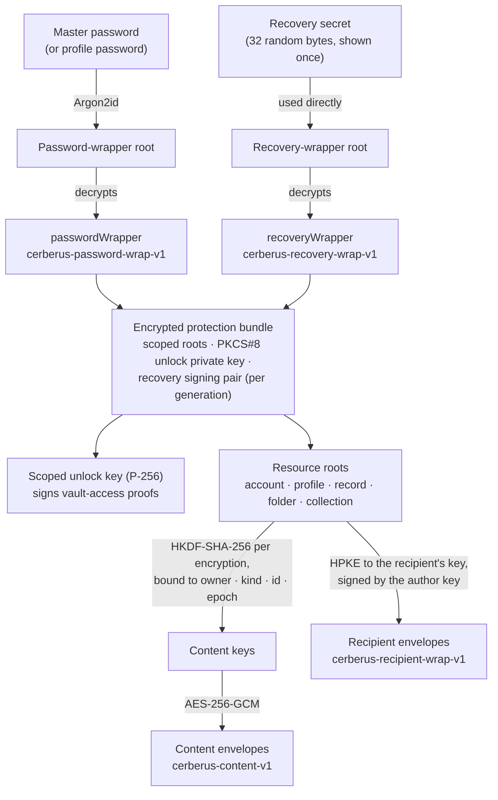
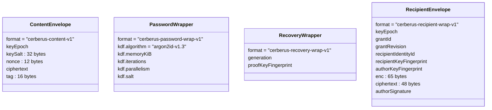
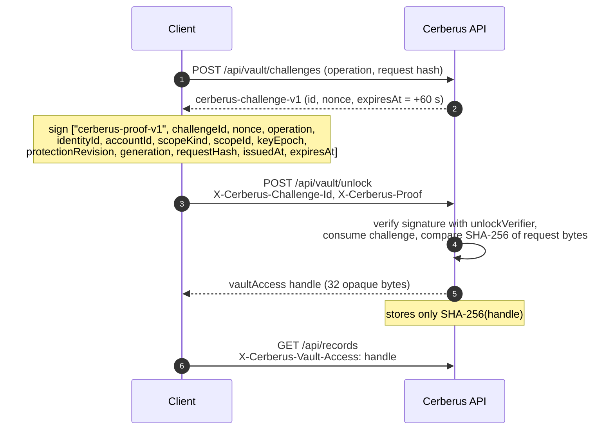

+++
title = 'Security model'
linkTitle = 'Security model'
weight = 40
description = 'What the client holds, what the server stores, the key hierarchy, envelopes, proofs, offline leases — and the protocol review that gates release.'
+++

{}
The Cerberus protocol described here is **proposed, pending independent security review and
real-client interoperability review**. The review was explicitly deferred for development; it
remains required before any release. See [Review status](#review-status).
{}

## Who holds what

| | Client (in memory, unlocked) | Server (PostgreSQL, backups) |
| --- | --- | --- |
| Plaintext content | ✅ only while displayed | ❌ never |
| Vault and profile passwords | ✅ only while typed | ❌ never — not even a hash |
| Recovery secret | ✅ only while shown or typed | ❌ never |
| Usable vault keys | ✅ until the vault locks | ❌ never |
| Ciphertext envelopes | ✅ (and in the local store, default mode) | ✅ |
| Password and recovery wrappers | ✅ | ✅ opaque |
| Public keys and verifiers | ✅ | ✅ (JWKs; SHA-256 of handles) |
| Counters (revisions, epochs, generations) | ✅ | ✅ |
| Offline lease signing key | ❌ | ✅ |

The design goal is that **a database, a backup, or a server holding the identity credentials and
the lease-signing key cannot decrypt a vault**.

## Primitives

| Purpose | Construction |
| --- | --- |
| Content encryption | **AES-256-GCM** — 32-byte key, 12-byte nonce, 16-byte tag |
| Password key derivation | **Argon2id v1.3** — 65 536 KiB, 3 passes, 4 lanes, 16-byte salt, 32-byte output |
| Envelope subkeys | **HKDF-SHA-256** with domain-separated labels |
| Recipient key wrapping | **HPKE** (RFC 9180) base mode — DHKEM(P-256, HKDF-SHA256), HKDF-SHA256, AES-256-GCM |
| Signatures and proofs | **ECDSA P-256 / SHA-256** (RFC 6979, 64-byte P1363 encoding) |
| Key fingerprints | **RFC 7638** JWK SHA-256 thumbprints, unpadded base64url |
| Recovery secret, challenge nonce | 32 random bytes |
| Offline lease | **ES256 JWS** verified against pinned keys |

Version 1 uses classical P-256 and claims no quantum resistance.

## Key hierarchy

Both wrappers decrypt the **same** protection bundle — the password for everyday unlock, the
recovery secret when the password is lost. Each recovery generation has its own signing pair,
encrypted inside the bundle; the server holds only its public verifier, and there is no endpoint
that ever returns recovery plaintext.

When a collection or a secret is shared, the owner wraps the collection's (or record's) root for
the recipient with HPKE base mode, and signs the wrap with a separate **author** key. Base mode
alone does not authenticate a sender, so the recipient verifies its pinned fingerprints and the
author signature before decapsulating.

- **Vault protection material** stored on the server is `passwordWrapper`, `recoveryWrapper`,
  `unlockVerifier`, `recoveryVerifier`, `recipientKey` and `authorKey`. The four public keys must be
  distinct P-256 JWKs.
- **Changing the password** uses fresh salts and nonces and increments the protection-slot epoch;
  it keeps the inner roots, so content is not re-encrypted (see
  [Vault protection](/docs/flows/vault-protection/#changing-protection) for the full rotation).
- **Profiles** in *per-profile* mode carry their own password wrapper. Every profile has an owner
  recipient wrapper and a distinct scoped unlock verifier, so opening one profile never opens
  another.
- **Distinct key pairs** are used for each role: recipient KEM, envelope author, scoped unlock, a
  per-generation recovery proof key, and the server's lease-signing key.

## Envelopes

Every piece of content travels as a versioned envelope:

The content key and the authenticated data are derived from, and bound to, the **format, owner id,
resource kind, resource id, key epoch** and an extra context. The client verifies that binding on
every envelope it opens; a mismatch is reported as *tampered* and nothing is displayed. A nonce is
never reused under the same key.

## Proving vault access

Signing in yields only an identity token. To read or change the vault, the client proves it holds
the unlock key by signing a single-use challenge:

- A challenge is valid for exactly **60 seconds**, can be consumed once, and is bound to the
  SHA-256 of the exact request bytes — the API keeps the original body for this and never
  re-serializes JSON for a proof.
- Proof operations are `unlock-account`, `change-protection`, `recover` and `refresh-recovery`;
  opening one profile has its own challenge endpoint (`/api/profiles/{id}/access/challenges`).
- A handle is **account-wide** or **scoped to one profile**, and carries the policy revision and
  revocation generation it was issued under: changing protection, the offline policy, or a share
  increments them, and older handles go stale.

## Offline leases

An offline lease lets a device keep using its ciphertext store while disconnected.

| Claim | Value |
| --- | --- |
| `alg` | `ES256` |
| `typ` | `cerberus-offline-v1+jwt` |
| `aud` | `cerberus-offline-clients-v1` |
| `nbf` | `= iat` |
| `exp` | `iat` + the account's renewal interval (86 400 s by default); **omitted** when renewal is disabled |

The client uses a lease only after its signature verifies against a **pinned** key, checks that it
names this account and scope, and judges expiry against the later of the device clock and the
latest time it has observed — so rolling the clock back never extends a lease. An expired lease
locks the offline vault until it is renewed online.

## What revocation can and cannot do

- Revoking a share or a software grant, closing an account or changing protection **stops future
  access** immediately on the server and rotates the relevant epochs and generations.
- A device that is offline learns of a revocation **when it reconnects**, and applies revocations
  before showing any new content.
- **Nothing retracts what was already copied.** The UI says so whenever it revokes.

## Client-side obligations

The client enforces what the server cannot see:

- Sign-in never unlocks; unlock is a separate, local step.
- Decrypted content exists only while displayed; hidden fields stay concealed until revealed.
- The vault locks on request, on inactivity (default 5 minutes, including while backgrounded), on
  sign-out, at session end and at lease expiry — discarding keys and decrypted items.
- A copied secret is cleared from the clipboard after an interval (default 30 seconds), unless the
  clipboard has changed since.
- Content is excluded from screenshots and the recent-apps preview where the platform allows.
- A recipient's key is never trusted because the API supplied it: its fingerprint is verified out of
  band before the first share, and a changed fingerprint blocks sharing until re-verified.

## Review status

| Item | State |
| --- | --- |
| Independent security review | **Pending** (`protocol-review.json`: `status: "pending"`) |
| Real-client interoperability review | **Pending** |
| Owner deferral | `development-review-deferral.json`, authorized 2026-10-08: development and merges into `develop` only; excludes production deployment, release approval and any claim that review passed |
| Release gate | `scripts/verify_protocol.py` intentionally fails, blocking `main`, release pull requests and tags |
| Reference harnesses | Java (Bouncy Castle) and Python (`cryptography`), with 322 interoperability vectors |
| Client protocol gate | `approvedProtocolVersion = null` — every encrypting client flow is disabled |

The client is part of the review: an independent client implementation is what produces and checks
the interoperability vectors the review requires.
