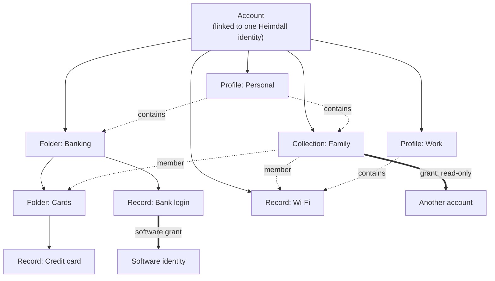

+++
title = 'Domain model'
linkTitle = 'Domain model'
weight = 10
description = 'The entities the Cerberus API stores and how they relate.'
+++

## How a vault is organized

- **Everything belongs to one account.** Records, folders, collections and profiles are owned by
  exactly one account; ownership never transfers.
- **A record sits in zero or one folder**; folders nest, without cycles.
- **Profiles and collections are selections**, not containers: the same record or folder can be
  in several profiles and several collections. A collection's folder membership includes that
  folder's descendants dynamically.
- **Profiles are never shared.** Collections are shared with accounts; records and collections
  can be granted to software.
- A recipient adds a collection shared with them to one of **their own** profiles; granting
  creates no profile association by itself.

## Entity relationships

```mermaid
erDiagram
    ACCOUNT ||--|| VAULT_PROTECTION : "protected by"
    ACCOUNT ||--o{ PROFILE : owns
    ACCOUNT ||--o{ VAULT_FOLDER : owns
    ACCOUNT ||--o{ VAULT_RECORD : owns
    ACCOUNT ||--o{ VAULT_COLLECTION : owns
    ACCOUNT ||--o{ SOFTWARE_GRANT : issues
    ACCOUNT ||--o{ VAULT_ACCESS_SESSION : opens
    ACCOUNT ||--o{ TRASH_OPERATION : deletes
    ACCOUNT ||--o{ SYNC_STREAM : syncs

    VAULT_FOLDER |o--o{ VAULT_FOLDER : "parent of"
    VAULT_FOLDER |o--o{ VAULT_RECORD : contains

    PROFILE ||--o{ PROFILE_RECORD : ""
    PROFILE ||--o{ PROFILE_FOLDER : ""
    PROFILE ||--o{ PROFILE_COLLECTION : ""
    VAULT_RECORD ||--o{ PROFILE_RECORD : ""
    VAULT_FOLDER ||--o{ PROFILE_FOLDER : ""
    VAULT_COLLECTION ||--o{ PROFILE_COLLECTION : ""

    VAULT_COLLECTION ||--o{ COLLECTION_RECORD : ""
    VAULT_COLLECTION ||--o{ COLLECTION_FOLDER : ""
    VAULT_RECORD ||--o{ COLLECTION_RECORD : ""
    VAULT_FOLDER ||--o{ COLLECTION_FOLDER : ""

    VAULT_COLLECTION ||--o{ COLLECTION_GRANT : "shared by"
    ACCOUNT ||--o{ COLLECTION_GRANT : "receives"

    SOFTWARE_GRANT ||--o{ SOFTWARE_GRANT_RECORD : targets
    SOFTWARE_GRANT ||--o{ SOFTWARE_GRANT_COLLECTION : targets
    VAULT_RECORD ||--o{ SOFTWARE_GRANT_RECORD : ""
    VAULT_COLLECTION ||--o{ SOFTWARE_GRANT_COLLECTION : ""

    TRASH_OPERATION ||--|{ TRASH_ENTRY : "groups"
    SYNC_STREAM ||--o{ SYNC_INVENTORY : ""
    SYNC_STREAM ||--o{ SYNC_CHANGE : ""

    ACCOUNT {
        guid PublicId
        guid HeimdallPublicId "unique"
        bytes DetailsEnvelope
        long Revision
        enum State "Active | ClosurePending"
        datetime ClosureRequestedAt
        datetime ClosurePurgeAt
        bool RenewalEnabled "default true"
        timespan RenewalInterval "default 24h"
        long PolicyRevision
        long RevocationGeneration
    }
    PROFILE {
        guid PublicId
        bytes Envelope
        enum UnlockMode "Master | PerProfile"
        json KeyWrappers
    }
    VAULT_RECORD {
        guid PublicId
        bytes Envelope "name, fields, template"
        bigint FolderId "nullable"
    }
    VAULT_FOLDER {
        guid PublicId
        bytes Envelope
        bigint ParentFolderId "nullable"
    }
    VAULT_COLLECTION {
        guid PublicId
        bytes Envelope
        long KeyEpoch
    }
    COLLECTION_GRANT {
        guid PublicId
        enum Access "ReadOnly | ReadWrite"
        enum State "Active | Revoked"
        long Revision
        bytes RecipientKeyEnvelope
    }
    SOFTWARE_GRANT {
        guid PublicId
        guid HeimdallSoftwarePublicId
        json RecipientKey "P-256 JWK"
        enum State "Active | Revoked"
        long Revision
    }
    VAULT_PROTECTION {
        long Revision
        long KeyEpoch
        long RecoveryGeneration
        json Material "wrappers + public verifiers"
    }
    VAULT_ACCESS_SESSION {
        bytes HandleVerifier "SHA-256"
        bigint ProfileId "null = account-wide"
        datetime ExpiresAt
        long PolicyRevision
        long RevocationGeneration
        bool Revoked
    }
    TRASH_OPERATION {
        guid PublicId
        enum RootResourceKind
        datetime DeletedAt
        datetime PurgeAt "+720 h"
    }
    TRASH_ENTRY {
        enum ResourceKind
        bigint ResourceId
        json AssociationSnapshot
    }
```

### Common fields of owned resources

`Profile`, `VaultRecord`, `VaultFolder` and `VaultCollection` share:

| Field | Meaning |
| --- | --- |
| `Id` | Internal `bigint` key, never exposed. |
| `PublicId` | The GUID clients see. Generated by the client for offline creates; reserved forever after deletion. |
| `AccountId` | The owner. Immutable. |
| `Envelope` | The ciphertext. For a record, the name, the fields, their types and the template live in here — the server sees none of them. |
| `Revision` | Optimistic concurrency counter; online writes send `expectedRevision`. |
| `EditedAt` | Client UTC edit time — the basis of latest-edit-wins synchronization. |
| `ServerSequence` | Position in the global `cerberus.server_sequence`, used to order sync changes. |
| `DeletedAt`, `PurgeAt` | Set when the resource is in the trash. |

### Supporting entities

| Entity | Purpose |
| --- | --- |
| `VaultUnlockChallenge` | A single-use 60-second proof challenge, bound to the policy revision and revocation generation. |
| `VaultRecoveryOperation` | Idempotency record of a recovery: key, original body digest and committed counters. |
| `RegistrationOperation` | Idempotency record of a registration, with an HMAC fingerprint of the request. |
| `TerminalErasure` | The tombstone: a unique `(resource_kind, resource_id)` for accounts, profiles, records, folders, collections and grants. |
| `RetentionWorkItem` | A due retention job: operation key, due time, claim token and expiry, attempts. |
| `SyncStream`, `SyncInventory`, `SyncChange` | A profile-scoped synchronization stream, the fingerprints of what the client has, and the ordered change feed. |
| `SyncOperation` | Idempotency ledger of uploaded offline edits. |
| Erasure ledger | Not in the database: files holding only the id, kind and deletion time of completed erasures. |

The **offline policy** is not a separate entity — it lives on the account (`RenewalEnabled`,
`RenewalInterval`, `PolicyRevision`). The **offline lease** is not stored; it is a signed token
issued on request.

## Records

A record is the unit of content. The server stores only its envelope; inside it, the client keeps:

| Element | Rule |
| --- | --- |
| Name | Required. No length or uniqueness limit. |
| Fields | Any number, user-defined, each of type **text**, **numeric**, **boolean** or **hidden text**. A numeric field accepts only a number; a hidden field stays concealed until revealed. |
| Template | Optional. **Password** requires the password; **login** requires a username or email plus a password; **note** requires the note. Template-less records are allowed. |

Search and sorting happen on the device: no plaintext search term is ever sent to the API.
