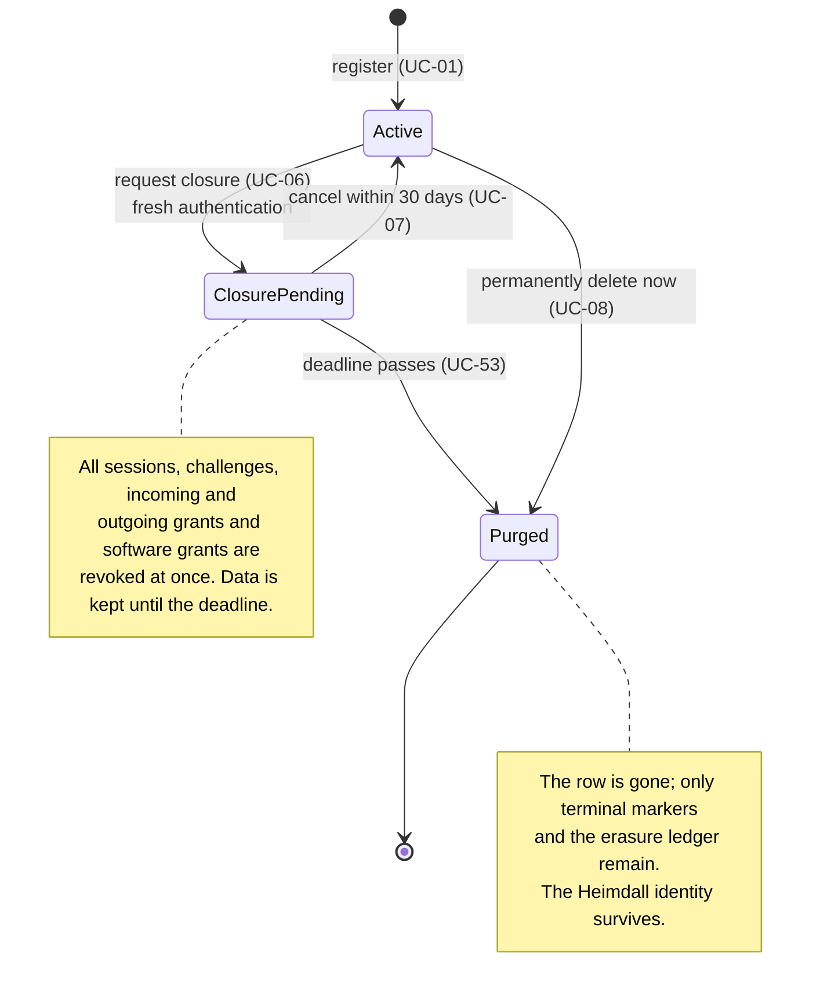
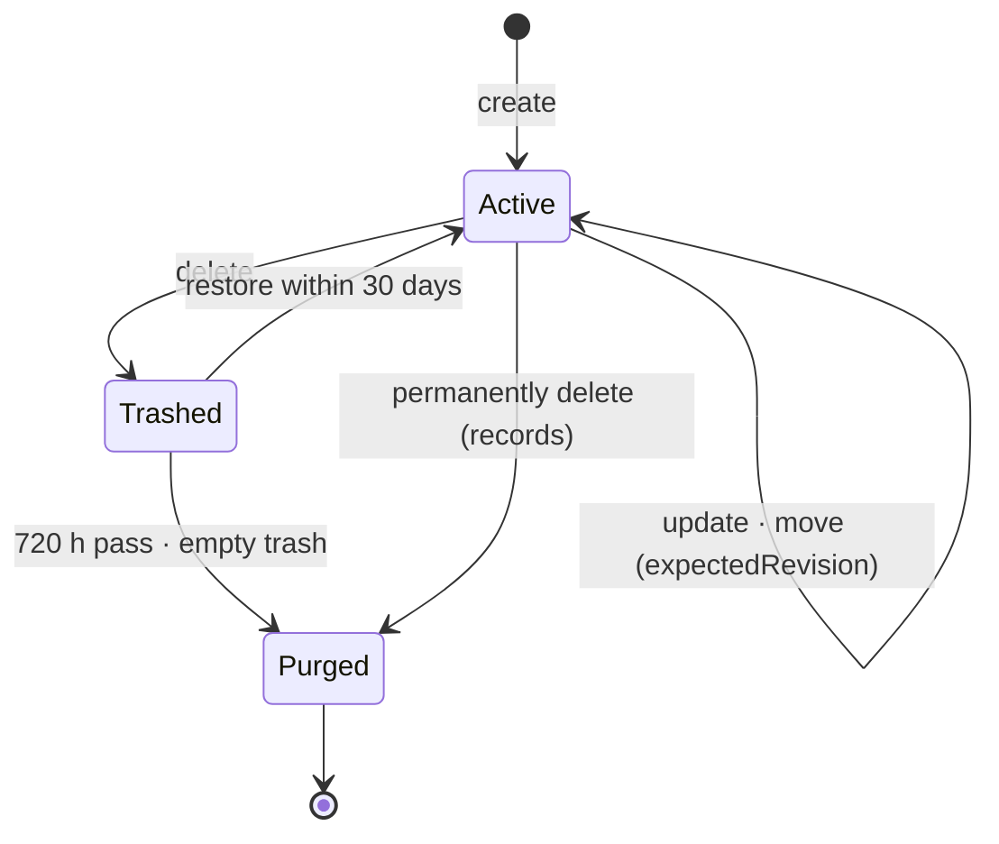
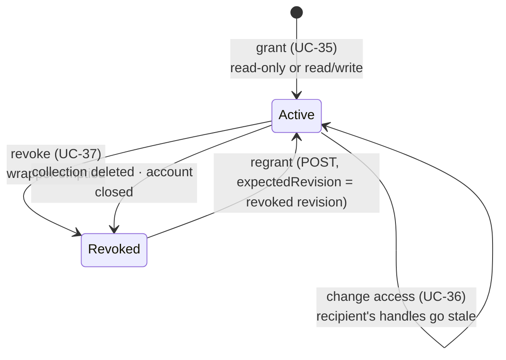
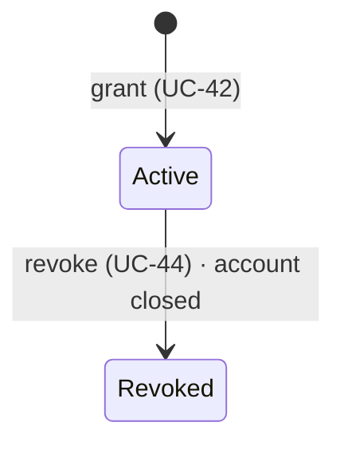
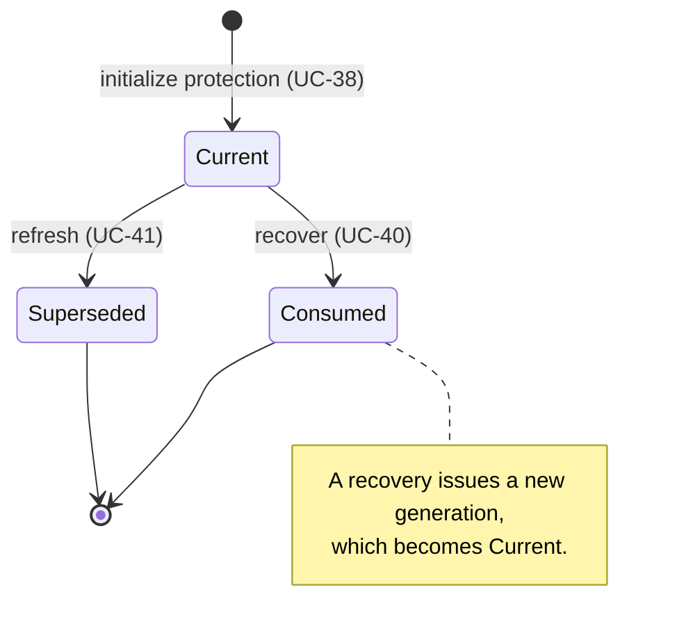
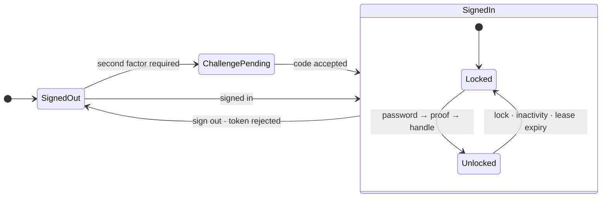
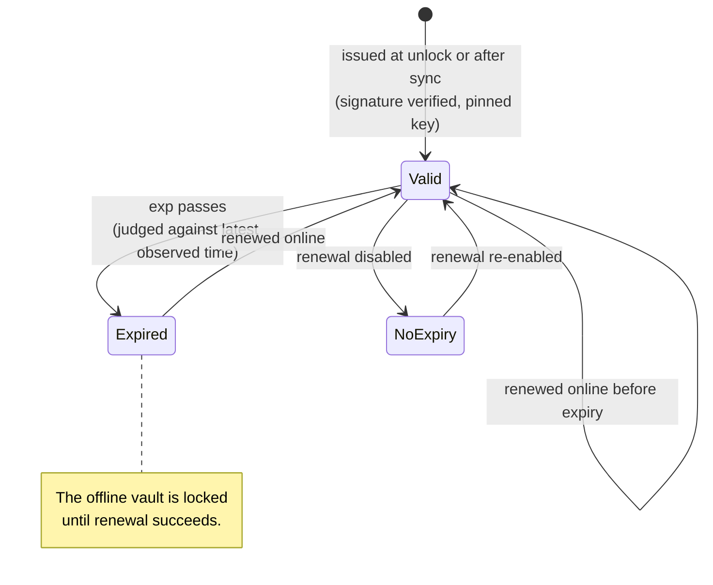

+++
title = 'Lifecycles'
linkTitle = 'Lifecycles'
weight = 30
description = 'The states that accounts, vault resources, grants, recovery keys and offline leases move through.'
+++

## Account

Cancelling a closure makes the account **Active** again, but revoked sessions and grants are not
revived: the owner unlocks again and re-shares.

## Records, folders, collections and profiles

What deleting takes with it differs by kind:

| Deleting a… | Goes to the trash | Kept |
| --- | --- | --- |
| **Record** | The record. | — |
| **Folder** | The folder, its nested folders and every record in them — one trash operation. | — |
| **Collection** | The collection and its associations. Its grants are **revoked**, and a restore does not revive them. | The member records and folders. |
| **Profile** | The profile and its associations. | The records, folders and collections. |

A restore revalidates links and reports what it could not restore. An entry that expires while
displayed is reported as permanently deleted, not as a failure.

## Collection grant

## Software grant

## Recovery key

A recovery credential completes **exactly one** recovery. A competing recovery with the same
credential gets `409 recovery_credential_consumed`; an exact retry gets the historical outcome.

## Vault access on the client

## Offline lease

