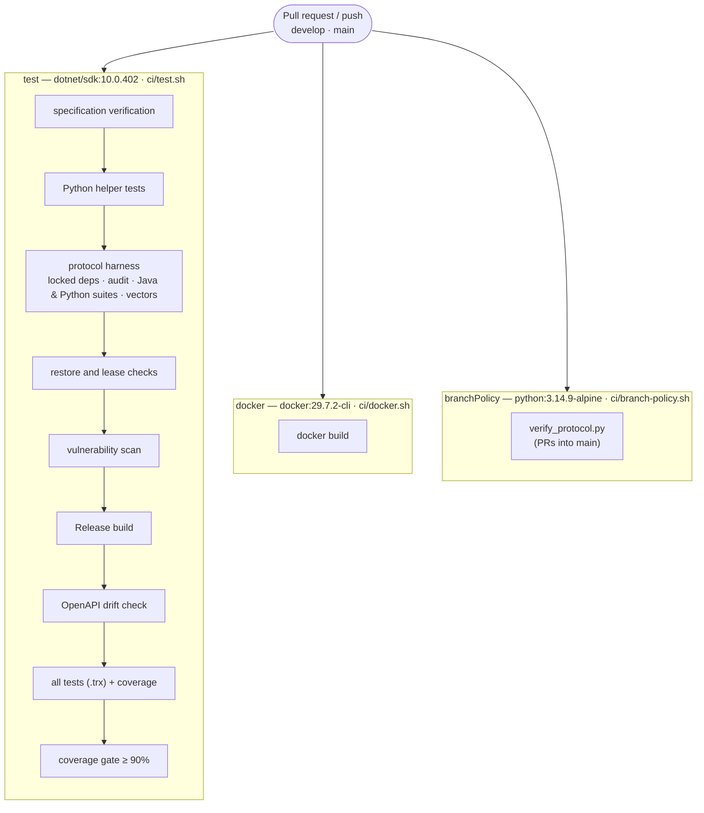

+++
title = 'Continuous integration'
linkTitle = 'Continuous integration'
weight = 40
description = 'The Jenkins checks each repository runs, driven by its yggdrasil.yml.'
+++

CI runs on **Jenkins**, through the owner's **yggdrasil** platform. Each repository declares its
checks in `yggdrasil.yml` — data, not code: pinned images, commands, archive globs and the names of
Jenkins credentials. Every command is a script under `ci/`, so you can run it on your own machine.

## API



| Check | Runs | Archives |
| --- | --- | --- |
| `test` | `ci/test.sh` — needs Docker for Testcontainers; uses the `reportgenerator-license` credential when present | `docs/coverage-report/**`, `**/TestResults/*.trx` |
| `docker` | `ci/docker.sh` — the image can still be built | — |
| `branchPolicy` | `ci/branch-policy.sh` — the protocol review gate for pull requests into `main` | — |

Required checks are `branch-policy`, `test` and `docker`; `main` also requires
`deploy/production`. Cerberus is not yet an application in yggdrasil's catalog, so nothing is
deployed and a release pull request cannot pass yet.

## Client

| Check | Image | Runs |
| --- | --- | --- |
| `analyze-and-test` | `ghcr.io/cirruslabs/flutter` (for the Android SDK and JDK; `ci/flutter-env.sh` fetches the pinned Flutter 3.47.4) | actionlint → `flutter pub get --enforce-lockfile` → `dart format --set-exit-if-changed` → `flutter analyze` → `tool/check_boundaries.dart` → `flutter test --coverage` → `tool/check_protocol_gate.dart`. Archives `coverage/lcov.info`. |
| `generated-drift` | — | Regenerates the API client, build_runner output, drift migrations and schema helpers and localizations, then fails on any `git diff`. |
| `web-bundle` | `docker:29.7.2-cli` | Builds the web image under a unique tag (running the bundle check), then removes it. |
| Release | owner `v*` tags | `ci/release-build.sh`: the tag must match `pubspec.yaml`; crypto tests and the gate check; builds web, APK, Linux and `.deb`. Windows is built by the `release-windows.yml` workflow. |

Checks run on every pull request into, and push to, `develop` and `main`.

## Running a check locally

Every check is a plain script:

```bash
ci/test.sh
ci/docker.sh
```

```bash
ci/analyze-and-test.sh
ci/generated-drift.sh
ci/web-bundle.sh
```
