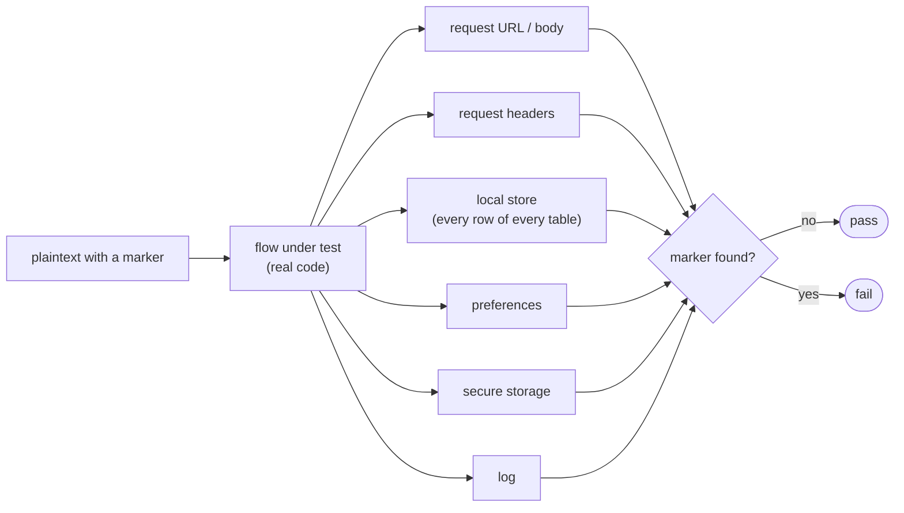

+++
title = 'Testing'
linkTitle = 'Testing'
weight = 30
description = 'How each repository tests: layers, naming, doubles, coverage, the leak rule and the protocol vectors.'
+++

## API

### Test projects

| Project | Tests |
| --- | --- |
| `tests/Domain/ArturRios.Cerberus.Domain.Tests` | Domain entities and rules |
| `tests/Application/ArturRios.Cerberus.Command.Tests` | Command handlers |
| `tests/Application/ArturRios.Cerberus.Query.Tests` | Query handlers |
| `tests/Application/ArturRios.Cerberus.Shared.Tests` | Configuration, the Heimdall adapter, leases |
| `tests/Infrastructure/ArturRios.Cerberus.Data.Tests` | Persistence, migrations, erasure |
| `tests/Presentation/ArturRios.Cerberus.WebApi.Tests` | HTTP contracts end to end |
| `tests/TestSupport` | Shared fixtures |

### Conventions

- Names follow `GivenX_WhenY_ThenZ`, with Given / When / Then comments in the body.
- Tests are marked `UnitFact` / `UnitTheory` or `FunctionalFact` / `FunctionalTheory`, and filtered by
  `Category=Unit` or `Category=Functional`.
- Functional tests use a **real PostgreSQL** through Testcontainers (restore tests use PostgreSQL
  18) and controlled Heimdall HTTP fixtures — never an in-memory database.
- **Coverage gate: 90% merged line coverage** (`scripts/coverage.py`); branch coverage is reported
  without a gate.

```bash
dotnet test src/ArturRios.Cerberus.sln --filter "Category=Unit"
dotnet test src/ArturRios.Cerberus.sln --filter "Category=Functional"
dotnet test src/ArturRios.Cerberus.sln --collect:"XPlat Code Coverage"
```

### Verification scripts

| Script | Checks |
| --- | --- |
| `scripts/verify_specs.py` | The specification documents are consistent. |
| `scripts/openapi.py` | The OpenAPI contract matches the code (`--write` regenerates it). |
| `scripts/vulnerabilities.py` | No vulnerable packages. |
| `scripts/offline_leases.py` | Offline lease issuance and verification. |
| `scripts/verify_protocol.py` | The protocol review has passed — **fails on purpose** until it does. |

### Protocol harness

Independent reference implementations in **Java** (Bouncy Castle) and **Python** (`cryptography`)
produce and check **322 interoperability vectors**, including negative cases, with locked
dependencies and audit. They are what a client implementation is checked against.

## Client

### Layers

| Layer | Covers |
| --- | --- |
| Unit | Validation, cryptography, state, repositories, synchronization. |
| Widget | Anything a user sees: the locked, loading, loaded, empty and failed states (with retry), each visible `AF-xx`, concealment of hidden fields, and that disallowed actions are absent. |
| Integration | A complete journey in `integration_test/` against a stubbed API, with the real router, providers, cryptography and — for default-mode journeys — a real temporary local store. |

`test/` mirrors `lib/` exactly: `lib/<path>/thing.dart` is tested by `test/<path>/thing_test.dart`.

### Conventions

- Names are Given / When / Then sentences that cite the flow:
  `'Given … When … Then … (UC-42 AF-02)'` — so auditing alternative-flow coverage is a search.
- Bodies use arrange / act / assert separated by blank lines; `group()` is named after the unit.
- Doubles: hand-written fakes for repositories, `mocktail` for single-method collaborators, a
  recording stub for dio's `HttpClientAdapter`, drift in memory, recording in-memory storage, an
  injected clock (`DateTime.now()` never appears in production code) and a fake clipboard.
- Coverage is measured (lcov) and archived, not gated.

### The leak rule

**A flow without a leak assertion is not done.** Every flow that sends content or keys, or writes
storage, seeds its plaintext with a distinctive marker, runs through the real code with recording
doubles, and asserts the marker appears in none of the leak channels.



`expectOnlyIn` lets a token test expect the token in secure storage and nowhere else. Two standing
tests back the rule: the web storage wrappers write nothing, and the dio instance has no cache
interceptor.

### Cryptography vectors

RFC known-answer vectors (AES-256-GCM, HKDF-SHA-256, Argon2id, HPKE, ECDSA P-256, ES256) and the
Cerberus interoperability vectors from the API's harnesses — wrong owner, resource, epoch or
fingerprint; nonce, tag and encoding corruption; replayed challenges; malformed leases. Vectors are
data files, never computed by the code under test; they arrive with the protocol approval.

### Required journeys

- Register → protect → create a record → lock → unlock → reveal.
- Sign in with a second factor *(the one that exists today)*.
- Share, and see it read-only as the recipient.
- Edit offline → reconnect → synchronization outcomes.
- A revocation is removed first.
- A web reload lands on sign-in with nothing persisted.

```bash
flutter analyze
flutter test
flutter test --coverage
flutter test test/core/crypto
flutter test integration_test -d linux
```
