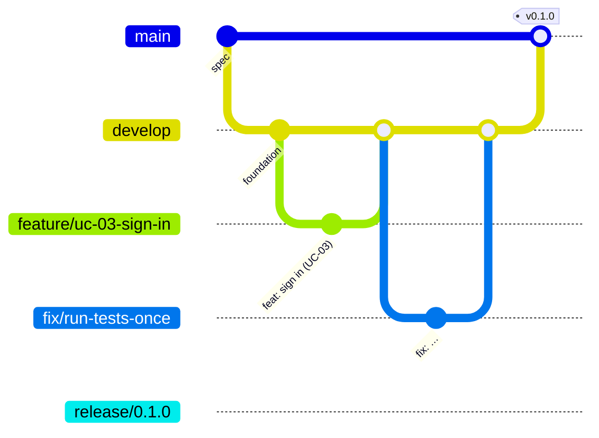
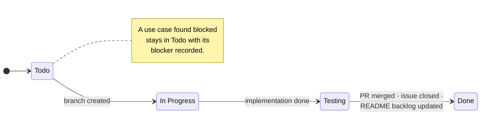
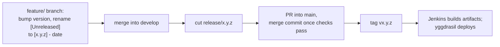

+++
title = 'Workflow'
linkTitle = 'Workflow'
weight = 10
description = 'Branching, the issue lifecycle and its approval gates, the Definition of Done, commits, versioning and releases.'
+++

## Branching

| Branch | Purpose |
| --- | --- |
| `main` | Released code only (in the API, the specifications until the first release). Protected. |
| `develop` | Integration. Protected. |
| `feature/uc-##-use-case-name` | One use case — zero-padded number, lowercase kebab-case, no punctuation: `feature/uc-03-sign-in`, `feature/uc-20-set-a-profiles-contents`. |
| `fix/<name>` | A fix, from and into `develop`. |
| `release/x.y.z` | A snapshot of `develop` with no commits of its own, merged into `main` with a merge commit and tagged `vx.y.z`. |
| `renovate/*` | Dependency updates. |

`develop` and `main` accept no direct pushes, no force pushes and no deletion; `v*` tags are
protected.

## Issue lifecycle

**One use case = one issue = one branch = one pull request.** Issues move only forward, through
the project board's `Status` field:

### Approval gates

| Gate | Before | What is approved |
| --- | --- | --- |
| 1 | Writing code | The design and the plan. |
| 2 | Moving to Testing | What was built, flow by flow. |
| 3 | Opening the pull request | The passing suite — read, not asserted. |
| 4 | Done | The merge happened and the branch is gone. |

Review and merge are human acts. An explicitly authorized batch run may let an agent merge its own
pull requests under strict conditions — authorization naming the use cases up front, no bypassed
protections, never a protocol-blocked use case — and any failure stops the run.

## Definition of Done

- A feature branch from `develop`.
- The main flow and **every** alternative flow (`AF-xx`) implemented.
- Unit, widget/functional and — where required — integration tests.
- Analysis clean and the full suite green.
- *(Client)* a leak test for every content-bearing request or storage write.
- *(API)* merged line coverage of at least 90%, the OpenAPI contract regenerated.
- Generated code not hand-edited.
- The pull request merged into `develop` and the branch deleted.
- The issue Done and closed; the README backlog row updated.

## Commits and changelog

- [Conventional Commits](https://www.conventionalcommits.org/) with a lowercase subject:
  `feat: unlock the vault (UC-13)`, `fix: …`, `docs: …`, `build: …`, `chore: …`.
- User-visible changes go under `## [Unreleased]` in `CHANGELOG.md`
  ([Keep a Changelog](https://keepachangelog.com/)), in the same pull request.

## Versioning and releases

Both applications use [Semantic Versioning](https://semver.org/).

- **API** — the version is the release branch's name. The OpenAPI `info.version` (`v1`) is
  independent of the release number.
- **Client** — `x.y.z+n` in `pubspec.yaml`; the build number `n` only increases (an Android
  requirement). A major version is needed for a dropped platform, a local store that cannot be
  migrated, a protocol version no longer read, a removed build setting or a required new API
  contract. The API contract version is recorded alongside the app version.

{}
Neither application has been released. A release of the API — and of every client flow that
encrypts — is blocked until the protocol review passes; the API's branch policy check fails pull
requests into `main` on purpose until then.
{}
