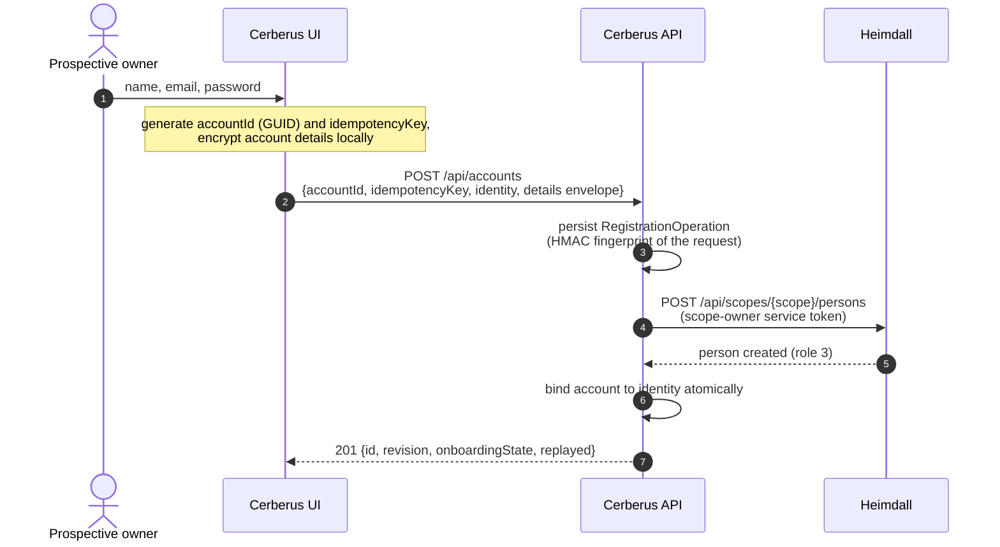
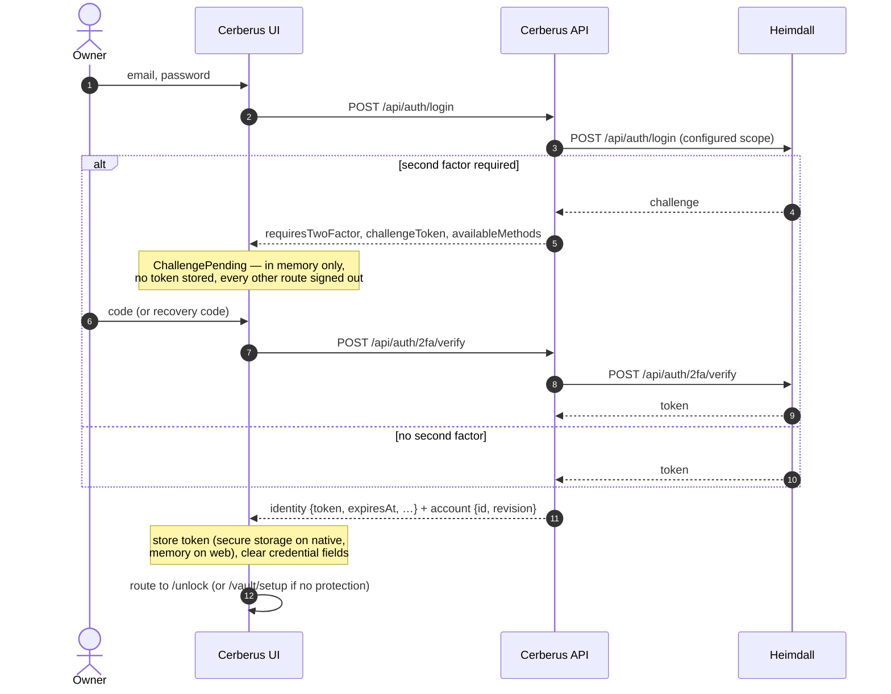
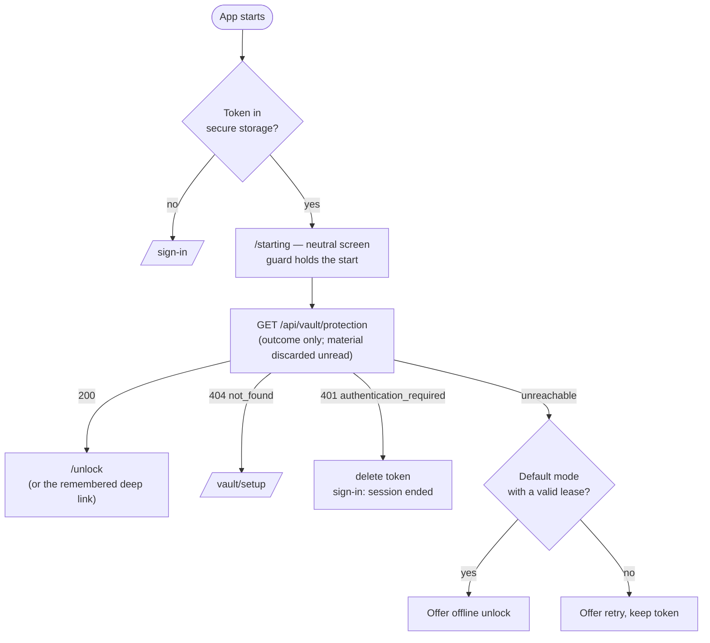
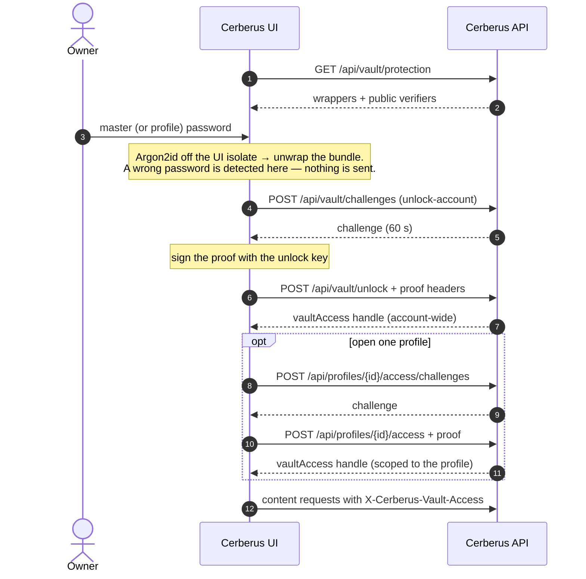

+++
title = 'Authentication and vault access'
linkTitle = 'Authentication'
weight = 10
description = 'Registration, sign-in with a second factor, session restore, sign-out, and unlocking the vault.'
+++

Cerberus keeps two questions apart:

1. **Who are you?** Answered by Heimdall. The result is a bearer token.
2. **Can you open this vault?** Answered on the device, by knowing the password, and proven to the
   API with a signed challenge. The result is a vault-access handle.

A token alone opens nothing: `GET /api/accounts/me` with only a token answers
`401 vault_access_required`.

## Registration

- The account id is generated by the client, so details can be encrypted before registration.
- A retry with the same idempotency key is reconciled with the stored operation and returns the
  same outcome (`replayed: true`); the fingerprint key `CERBERUS_REGISTRATION_FINGERPRINT_KEY`
  makes that comparison without storing the request.
- The scope owner must own exactly the configured scope; there is no global-admin fallback.

## Sign-in with a second factor

- Credentials exist only for the submission: never stored, logged or kept on a screen the user has
  left.
- A refused code shows the API's message, clears the field and keeps the challenge outstanding.
  Leaving the screen discards the challenge.
- If platform secure storage is unavailable, the app says the session cannot be kept and may
  continue for this run with the token in memory — it never falls back to preferences or a file.

## Session restore

On the web there is never a stored token: a reload always lands on sign-in.

## Unlocking the vault

- In **master** mode the user picks a profile after unlocking; in **per-profile** mode the password
  picks the profile. A device restricted to one profile offers only that one.
- A handle expires after 24 hours by default, or never when offline renewal is disabled, and goes
  stale as soon as protection, the offline policy or a share changes.

## Locking and signing out

| Trigger | Effect |
| --- | --- |
| The user locks | Close open records, overwrite key buffers, clear decrypted lists, clear the app's clipboard value, route to `/unlock`. |
| Inactivity (default 5 minutes, counted while backgrounded) | The same. |
| The offline lease expires | The same, until it is renewed online. |
| Sign-out | Lock, delete the token, discard in-memory state. In the default mode, ask whether to keep the ciphertext store or remove it — stating how many pending edits would be lost. |
| A token rejected mid-session | End the session and lock; keep the store. No silent refresh, no replay. |

An edit in progress when the vault locks is discarded, with a notice after the next unlock.

## Errors that matter here

| Response | Meaning | Client behaviour |
| --- | --- | --- |
| `401 authentication_required` on a request with a token | The identity token is no longer valid. | End the session and lock. |
| `401 vault_access_required` | Signed in but the vault is not unlocked (or the handle is stale). | Go to `/unlock`; the session stays. |
| `401` on a credential submission | Wrong credentials. | Show the message; the session is unaffected. |
| `503 identity_unavailable` | Heimdall is unreachable; the API fails closed. | Report and offer a retry. |
