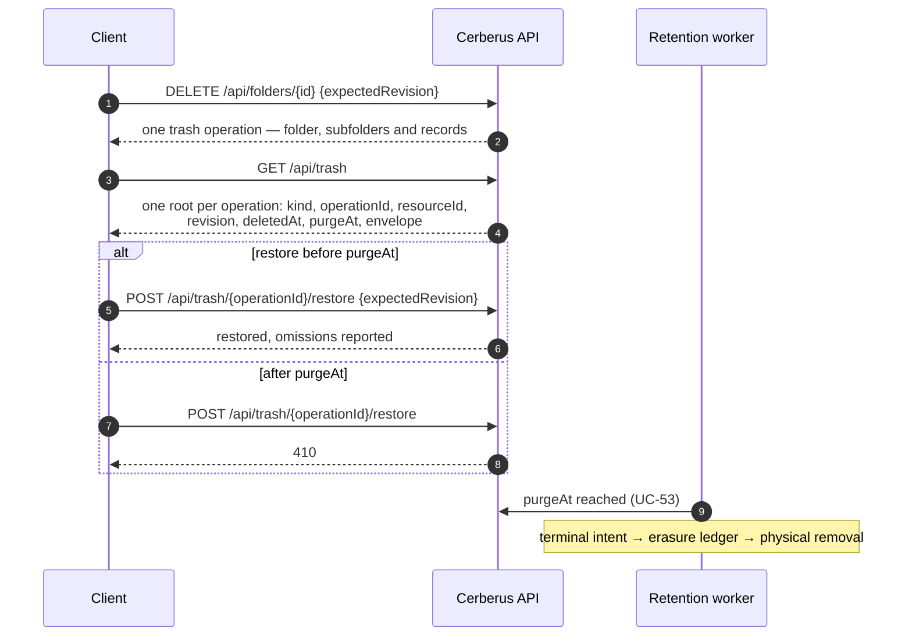
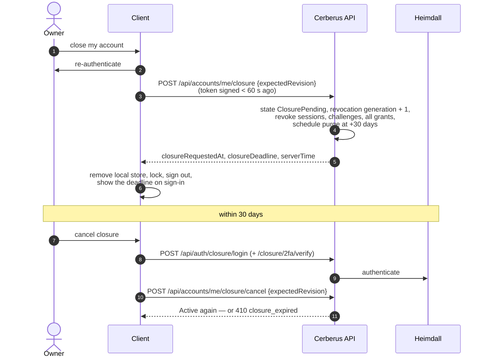
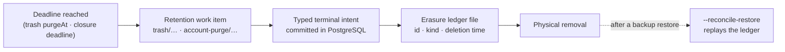

+++
title = 'Deletion, closure and export'
linkTitle = 'Deletion and export'
weight = 60
description = 'The 30-day trash, permanent deletion, retention expiry, account closure and its cancellation, immediate account deletion, and the privacy export.'
+++

## The trash

Deleting a record, folder, collection or profile moves it to the trash for **720 hours (30
days)**, keeping its ciphertext and a snapshot of its associations. Online deletes send
`expectedRevision`.

| Action | Endpoint |
| --- | --- |
| List the trash | `GET /api/trash` |
| Restore an entry | `POST /api/trash/{id}/restore` |
| Empty the trash now | `DELETE /api/trash` → `{accountId, purgedAt, counts, totalPurged}` |
| Delete a record permanently, skipping the trash | `DELETE /api/records/{id}/permanent` |

- A restored folder returns with the contents its deletion removed.
- A restored collection's shares are **not** revived.
- A permanent deletion writes a tombstone, so the item is never resurrected — not by a sync, not by
  a restored backup.

## Account closure

- After cancelling, old sessions and grants are **not** revived: the owner unlocks again and
  re-shares.
- When the deadline passes, the retention worker purges the account.

## Permanent account deletion

`DELETE /api/accounts/me/permanent` with `{expectedRevision}`, an account-wide vault-access handle
and a freshly signed token. The client asks the user to type a confirmation phrase and
re-authenticate, and says plainly that owned collections vanish for their recipients and that the
**Heimdall identity survives**.

The API writes typed terminal markers and `account-erase` work, flushes the erasure ledger, then
removes the data physically, answering `200 completed` or `202 pending`.

## Data export

`POST /api/accounts/me/export` returns a JSON attachment, `cerberus-account-export.json`, in the
`cerberus-account-export-v1` format — not wrapped in the usual response envelope. It holds the
account's data as the server holds it: ciphertext. The client saves it through the platform's
file dialog and can additionally offer a **decrypted** export, only after unlock, after stating and
confirming that the file will contain plaintext.

## Retention and erasure

Deadlines are checked at request time against database time, so a worker outage never extends
one. Completed deletions are reapplied after a backup restore — see
[Backup and restore](/docs/operations/backup-and-restore/).
