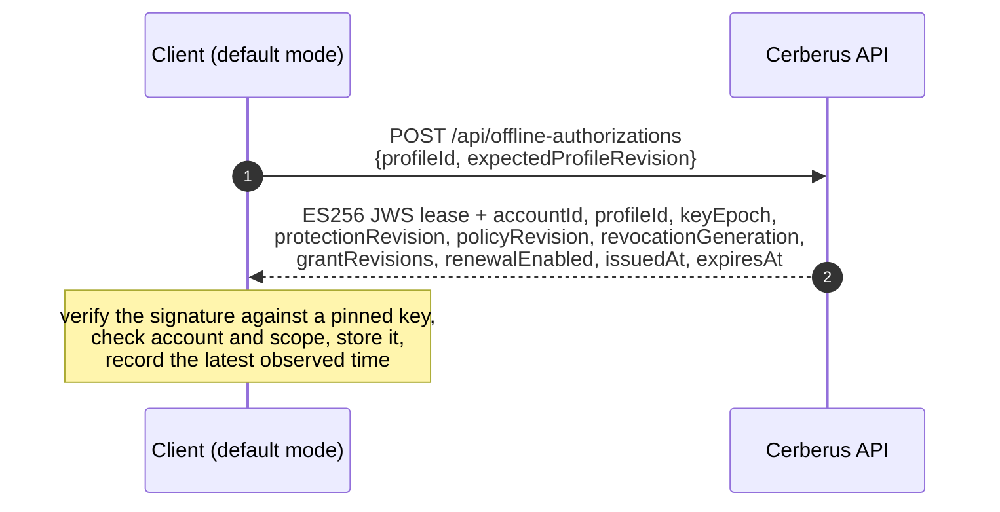
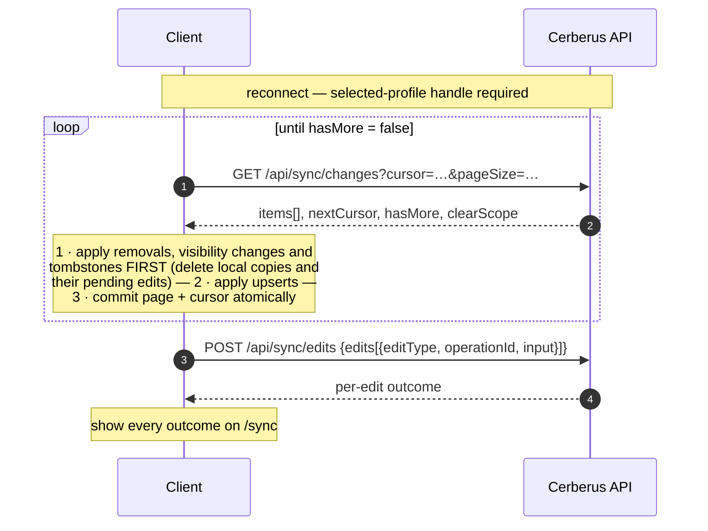
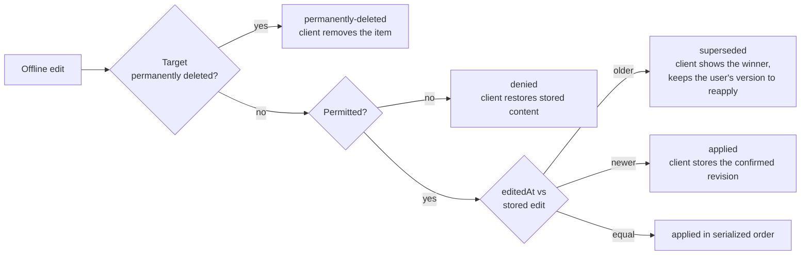

+++
title = 'Offline use and synchronization'
linkTitle = 'Offline and sync'
weight = 50
description = 'Storage modes, the offline policy, offline leases, downloading changes and uploading offline edits with latest-edit-wins.'
+++

## Storage modes

Each device chooses how much it keeps. The mode is always visible in the app.

| | **Default** (offline-capable) | **Online-only** |
| --- | --- | --- |
| Available on | Windows, Linux, Android | Windows, Linux, Android — and always on the web |
| Local store | drift (SQLite): envelopes, server-visible metadata, protection bundle, lease, cursor, pending edits — **ciphertext only** | None — everything in memory |
| Works offline | Yes, until the lease expires | No |
| Identity token | Platform secure storage | Secure storage (native) or memory (web) |

Switching to online-only warns about pending edits (offering to upload them first) and deletes the
store; if the deletion fails, the mode does not change. Switching back creates the store at the
next unlock and runs an initial synchronization.

## Offline policy

The account's policy decides how long a device may stay offline:

- **Enabled, 24 hours** — the initial setting.
- **Enabled, any positive interval** — `renewalInterval`, whole seconds.
- **Disabled** — leases never expire (with a warning): revocations land only when the device
  reconnects.

`GET` / `PUT /api/accounts/me/offline-policy` with `{expectedPolicyRevision, renewalEnabled,
renewalInterval}`. Every change increments `policyRevision`, which makes existing vault-access
handles stale.

## Offline leases

- The client requests a lease at unlock, after a sync, and before expiry.
- A lease with a bad signature or an unpinned key id is rejected, and the previous lease is kept.
- Expiry is judged against the later of the device clock and the latest time observed, so a clock
  rollback never extends it. When it expires, the offline vault locks until online renewal.
- Without the signing configuration the endpoint answers `503`.
- A lease authorizes **offline reading** only; it does not authorize uploads.

## Working offline

- Unlock against the local protection bundle.
- Edits are queued in the outbox as **ciphertext**, each with a client UTC edit time, a stable
  operation id, and — for new items — a client-generated UUIDv4 public id.
- Items show *saved on this device, pending synchronization*.
- Sharing, protection changes, permanent deletion and export are unavailable offline.

## Synchronization

### Download

- Each item carries `sequence`, `resourceKind` (profile, record, folder, collection, grant),
  `resourceId`, `eventType` (`upsert`, `removed` or `permanently-deleted`) and `data`. Removals
  come before upserts.
- The page size defaults to the smaller of 50 and `CERBERUS_MAX_PAGE_SIZE`.
- `409 resynchronization_required` (an invalid or expired cursor): clear the scope and take a fresh
  snapshot — pending edits are kept. Streams expire after `CERBERUS_SYNC_RETENTION`.
- An account-wide handle is refused: sync is always scoped to one profile.

### Upload and latest-edit-wins

Edit types: `record-create`, `record-update`, `folder-create`, `folder-update`,
`collection-create`, `collection-update`, `profile-create`, `profile-update`.

Updates carry **no expected revision**. The server compares the client's `editedAt` (normalized to
microseconds) with the stored edit time:

- Every outcome is shown; a superseded edit is never discarded silently.
- Retries reuse the same operation ids, so nothing applies twice. Reusing an operation id with a
  different payload is `409 operation_conflict`.
- A permanently deleted item is never resurrected.
