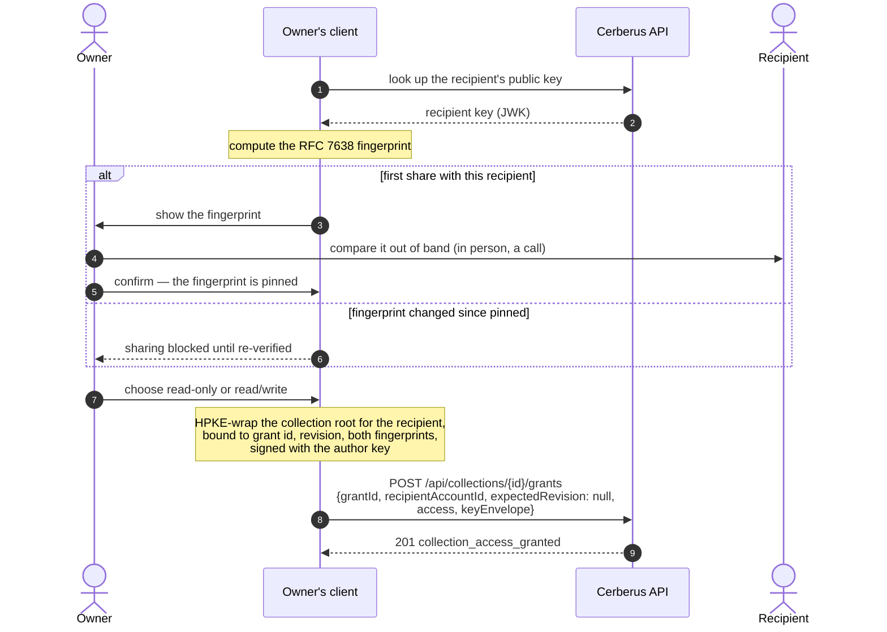
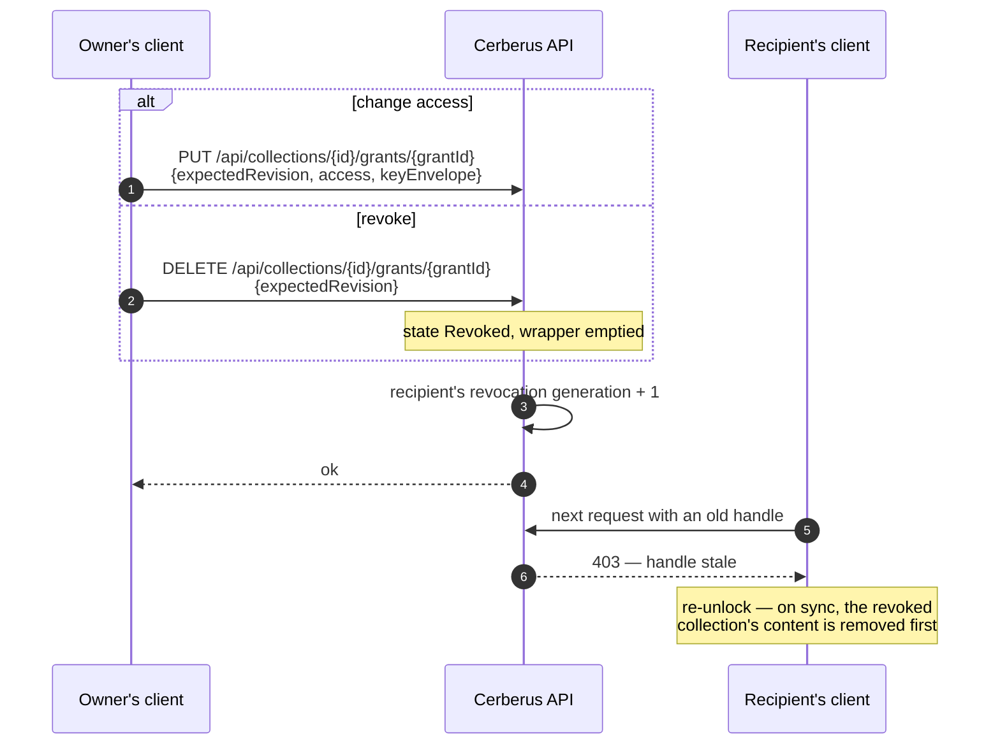

+++
title = 'Collection sharing'
linkTitle = 'Sharing'
weight = 30
description = 'Sharing a collection read-only or read/write after fingerprint verification, changing or revoking the share, and using a shared collection.'
+++

Only **collections** are shared — never profiles, never a whole vault — and only with another
Cerberus account that already has vault protection. A share is a **grant**: read-only or
read/write, managed only by the collection's owner.

| A recipient with… | Can |
| --- | --- |
| **read-only** | Read the effective members of the collection. |
| **read/write** | Read and edit the existing effective members. No deletion, no membership changes, no sharing administration. |

## Sharing a collection

{}
The API does not yet offer a lookup of a recipient's public key and fingerprint, nor a list of a
collection's grants; the client's sharing use cases (UC-30, UC-32, UC-33) wait on them. See
[Roadmap](/docs/reference/roadmap/#what-the-client-needs-from-the-api).
{}

- Without the owner's confirmation nothing is shared.
- Self-grants are refused with `400`.
- Granting creates no profile association: the recipient decides which of **their own** profiles
  shows the collection (`PUT /api/profiles/{id}/associations`).

## Using a collection shared with me

The recipient's client fetches the recipient envelope, verifies its pinned fingerprints and the
author's signature **before** decapsulating, then decrypts the members locally. Shared content is
always marked as shared, and actions the grant does not allow are not offered — though the API
enforces them regardless.

## Changing or revoking a share

- Revoking rotates the collection's key epoch for future content and says plainly that **copies
  already made cannot be retracted**.
- A revoked grant is revived only by a new `POST` grant carrying the revoked revision as
  `expectedRevision`.
- Deleting the collection, or closing the owner's account, revokes every grant; restoring the
  collection from the trash does **not** revive them.
