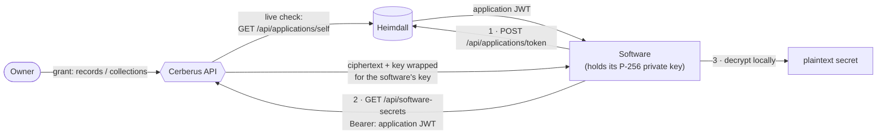
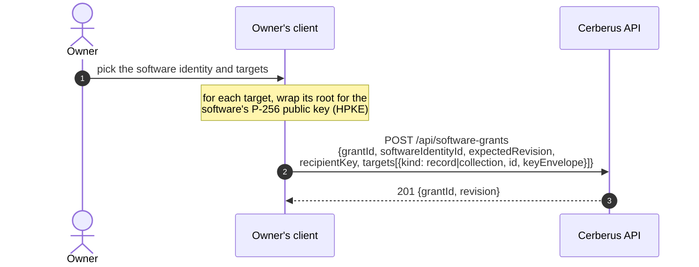

+++
title = 'Software access'
linkTitle = 'Software access'
weight = 40
description = 'Granting a software identity read access to selected records or collections, how software retrieves them, and revocation.'
+++

Software — a deployment script, a service, a CI job — can read **selected** secrets without a
person's password. It authenticates as a **Heimdall application identity** and receives only
ciphertext it decrypts with its own private key.



## Granting



## Retrieving

```text
GET /api/software-secrets?grantId=…&kind=record|collection&id=…[&collectionId=…]
Authorization: Bearer <Heimdall application token>
```

- Only this endpoint accepts an **application** token. It must carry `tokenKind=application` and
  the dedicated application audience, which must differ from the person audience; zero clock skew
  is allowed.
- Every read is checked live with Heimdall (`GET /api/applications/self`); there is no positive
  cache.
- The response (`software_secret_found`) carries `ownerAccountId`, `grantId`, `grantRevision`,
  `target`, `provisioning`, `recipientKey` and `authorKey`. Access is read-only.

## Revoking

`DELETE /api/software-grants/{id}` with `{expectedRevision}` revokes the grant. Closing the
account revokes all of its software grants. As with any revocation, anything the software already
fetched and decrypted cannot be retracted.
