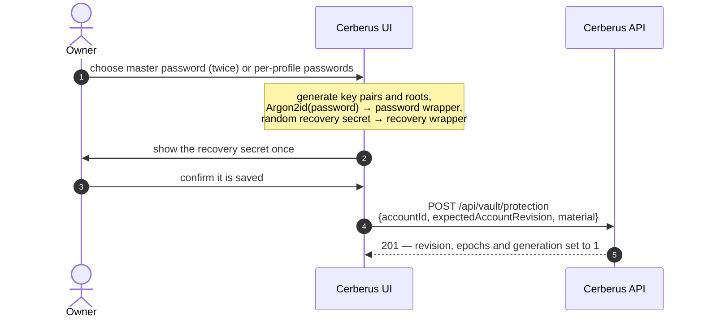
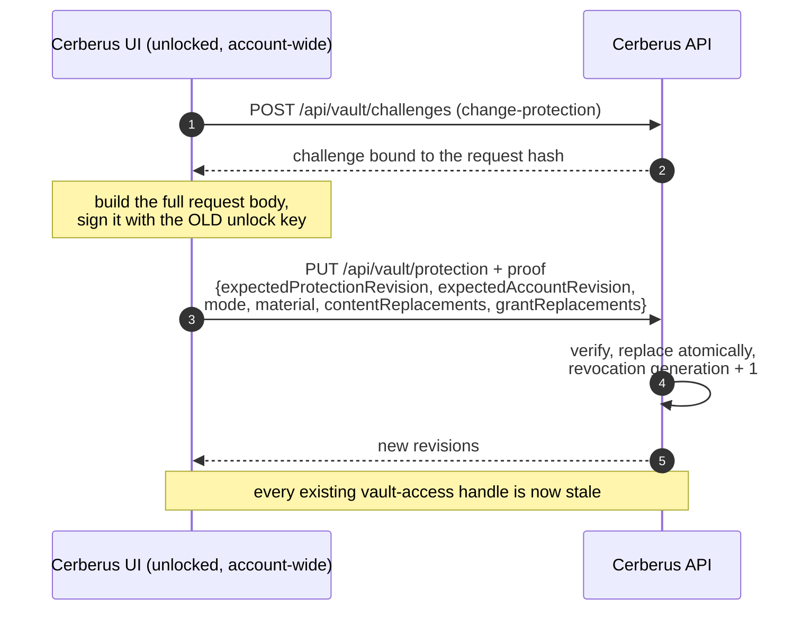
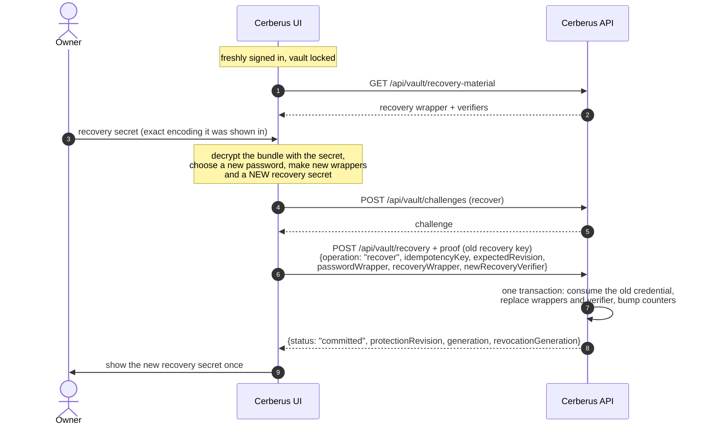
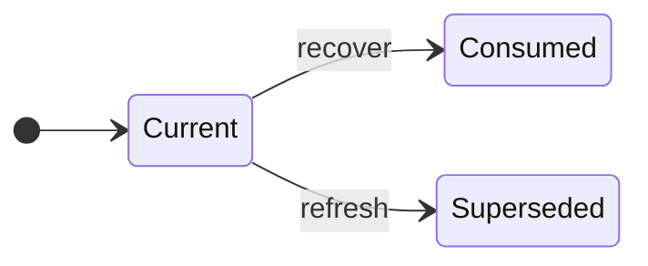

+++
title = 'Vault protection and recovery'
linkTitle = 'Vault protection'
weight = 20
description = 'Initializing protection, changing passwords or rotating content keys, recovering with the one-time key, and refreshing it.'
+++

## Initializing protection

After the first sign-in the account has no protection, and the client routes to `/vault/setup`.

`material` is exactly the opaque `passwordWrapper` and `recoveryWrapper` plus the public
`unlockVerifier`, `recoveryVerifier`, `recipientKey` and `authorKey` — four distinct P-256 JWKs.
Initializing needs no vault session; the protection material can be read back with
`GET /api/vault/protection` for local decryption.

## Changing protection

`PUT /api/vault/protection` changes protection in one of two modes:

| Mode | What changes | Content |
| --- | --- | --- |
| `rewrap` | New password wrapper(s), fresh salts and nonces, protection-slot epoch + 1. | Untouched — the inner roots are kept. |
| `rotate-content` | Everything in `rewrap`, plus new roots. | The account and **every** owned profile, record, folder and collection (trash included) are re-encrypted at content epoch + 1, and every active outgoing grant is re-wrapped. |

Changing protection never revokes keys a client has already copied.

## Recovering access

When the password is lost, the one-time recovery secret replaces it.

- The old recovery credential is **consumed**: a competing request gets
  `409 recovery_credential_consumed`; an exact retry of the same request returns the historical
  outcome.
- The server only ever sees the public recovery verifier; there is no endpoint that returns
  recovery plaintext.

## Refreshing the recovery key

At any time, while unlocked account-wide, the owner can replace the recovery secret:
`PUT /api/vault/recovery` (operation `refresh-recovery`), proven with the current unlock key. The
previous generation becomes **superseded** and stops working at once.

## Recovery key states

