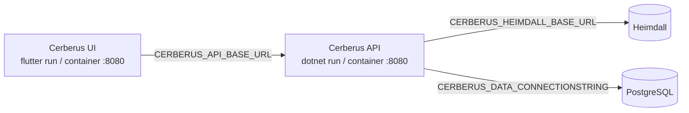

+++
title = 'Getting started'
linkTitle = 'Getting started'
weight = 20
description = 'Run the Cerberus API and the Cerberus UI on your own machine.'
+++

A working Cerberus needs three things running:

1. **A Heimdall instance** with a scope for Cerberus and a scope-owner service credential.
2. **PostgreSQL** and the **Cerberus API** — see [Run the API](run-the-api/).
3. **The Cerberus UI**, pointed at the API — see [Run the client](run-the-client/).

{}
No release has been made. The API container is a development artifact, not a release-ready vault
API, and the protocol review is required before production use.
{}
