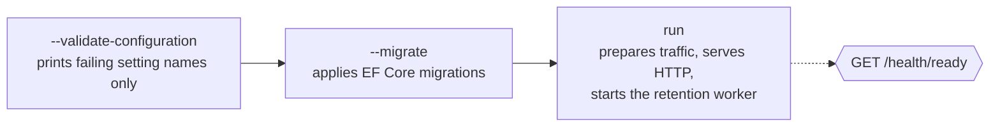

+++
title = 'Run the API'
linkTitle = 'Run the API'
weight = 10
description = 'Build, configure, migrate and start the Cerberus API, from source or as a container.'
+++

## Prerequisites

- The **.NET 10 SDK** — `global.json` asks for `10.0.100` with `rollForward: latestFeature`.
- **PostgreSQL** — the only supported database.
- A **Heimdall** instance: its base URL, the GUID of the scope Cerberus uses, a narrow scope-owner
  service credential, and the issuer, audiences and signing secret of the tokens it issues.
- A **Docker-compatible runtime** if you want to run the functional tests (they start PostgreSQL
  through Testcontainers).

## Clone

```bash
git clone https://git.techcraftsmen.net/artur-rios/cerberus-api.git
cd cerberus-api
git switch develop
```

`develop` holds the .NET solution; `main` holds only the specifications until the first release.

## Configure

The API **ships no production defaults**: starting it requires explicit database, Heimdall and
operational configuration. Every setting can be given as a `CERBERUS_…` environment variable or as
`Cerberus:<Property>` in `appsettings.json`; **environment variables win**. Copy the nonsecret
values from `docs/operations/appsettings.example.json` and supply credentials through protected
configuration.

A minimal development environment looks like this (values are illustrative):

```bash
export CERBERUS_DATA_DATABASETYPE=PostgreSql
export CERBERUS_DATA_CONNECTIONSTRING='Host=localhost;Database=cerberus;Username=cerberus;Password=…'
export CERBERUS_HEIMDALL_BASE_URL=https://heimdall.example.com
export CERBERUS_HEIMDALL_SCOPE_ID=00000000-0000-0000-0000-000000000000
export CERBERUS_HEIMDALL_SERVICE_CREDENTIAL='…'
export CERBERUS_AUTH_ISSUER=heimdall
export CERBERUS_AUTH_AUDIENCE=cerberus
export CERBERUS_AUTH_APPLICATION_AUDIENCE=cerberus-applications
export CERBERUS_AUTH_VALIDATION_SECRET='…at least 32 printable ASCII characters…'
export CERBERUS_REGISTRATION_FINGERPRINT_KEY='…another 32+ character secret…'
export CERBERUS_BACKUP_RETENTION=7.00:00:00
export CERBERUS_LOG_RETENTION=7.00:00:00
export CERBERUS_SYNC_RETENTION=30.00:00:00
export CERBERUS_RETENTION_INTERVAL=00:05:00
export CERBERUS_BACKUP_PATH=/srv/cerberus/backups
export CERBERUS_ERASURE_LEDGER_PATH=/srv/cerberus-erasure-ledger
export CERBERUS_MAX_REQUEST_BYTES=1048576
export CERBERUS_MAX_PAGE_SIZE=100
```

The full list, with every rule the validator enforces, is in [Configuration](/docs/operations/configuration/).

{}
`CERBERUS_REGISTRATION_FINGERPRINT_KEY` must be durable and independent: preserve it across
replicas, restores and routine rotation of the identity signing key.
{}

## Build, validate, migrate, run

From the repository root:

```bash
dotnet restore src/ArturRios.Cerberus.sln
dotnet build src/ArturRios.Cerberus.sln --no-restore
dotnet run --project src/Presentation/ArturRios.Cerberus.WebApi -- --validate-configuration
dotnet run --project src/Presentation/ArturRios.Cerberus.WebApi -- --migrate
dotnet run --project src/Presentation/ArturRios.Cerberus.WebApi
```



The executable accepts **exactly one** maintenance flag — `--validate-configuration`, `--migrate`
or `--reconcile-restore` (see [Backup and restore](/docs/operations/backup-and-restore/)); more than
one exits with `configuration_invalid`. Started without a flag, it first prepares traffic (running
restore reconciliation when `CERBERUS_RESTORE_REQUIRED` is set) and then serves requests.

Check it is up:

```bash
curl -s http://localhost:5000/health/live
curl -s http://localhost:5000/health/ready
```

## Run as a container

```bash
docker build -t cerberus-api .
docker run --rm -p 8080:8080 --env-file cerberus.env cerberus-api
```

The image is a multi-stage build — `mcr.microsoft.com/dotnet/sdk:10.0.402` to publish, then
`mcr.microsoft.com/dotnet/aspnet:10.0.13` to run, both pinned by digest. It listens on port
**8080** (`ASPNETCORE_HTTP_PORTS=8080`) as the unprivileged `app` user.

## Run the tests

```bash
dotnet test src/ArturRios.Cerberus.sln --filter Category=Unit
dotnet test src/ArturRios.Cerberus.sln --filter Category=Functional
```

Functional tests need Docker. See [Testing](/docs/development/testing/).
