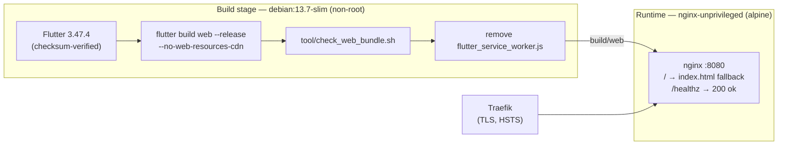

+++
title = 'Run the client'
linkTitle = 'Run the client'
weight = 20
description = 'Build and run Cerberus UI on the web, Windows, Linux or Android, and serve the web build as a container.'
+++

## Prerequisites

- The **Flutter SDK**, stable channel. CI, the Dockerfile and the Windows release workflow pin
  Flutter **3.47.4**; `pubspec.yaml` requires Dart `^3.13.2`.
- The toolchain for the platform you build:
  - **Linux:** `clang cmake ninja-build pkg-config libgtk-3-dev liblzma-dev libstdc++-12-dev libsecret-1-dev`.
  - **Windows:** Visual Studio with the desktop C++ workload.
  - **Android:** the Android SDK and a JDK.
  - **Web:** Chrome for `flutter run -d chrome`.
- A running [Cerberus API](/docs/getting-started/run-the-api/) to talk to.

## Clone and fetch dependencies

```bash
git clone https://git.techcraftsmen.net/artur-rios/cerberus-ui.git
cd cerberus-ui
git switch develop
flutter pub get
```

`main` holds only released code; development happens on `develop`.

## Run

Configuration is supplied **at build time**, so a run names the API instance it talks to:

```bash
flutter run -d linux --dart-define=CERBERUS_API_BASE_URL=http://localhost:5000
```

Replace `-d linux` with `windows`, `chrome` or your Android device id.

| Setting | Meaning |
| --- | --- |
| `CERBERUS_API_BASE_URL` | The only build define. The API instance's base URL. Empty or absent: the build names no instance and the app starts at `/setup`. It is compiled into the bundle and readable by anyone — an address, never a secret. |

- **Plain HTTP is accepted in debug builds only.** It is decided by the build mode, never by a
  define, so a release build cannot be talked into it.
- The address must be absolute, `https` (or `http` in debug), with a host and **no** query,
  fragment or user info; a trailing slash is stripped.
- On native targets an address the user adopts on the setup screen is kept in preferences and wins
  over the build default. On the web it lives in memory and a reload forgets it.
- The setup screen checks `GET /health/ready` and adopts the address only when the instance
  reports ready.

{}
The setup screen (UC-01) is not implemented yet, so `/setup` currently shows a placeholder: build
with `CERBERUS_API_BASE_URL` for now. Everything that encrypts waits for the protocol review — see
[Roadmap](/docs/reference/roadmap/).
{}

## Serve the web build as a container

The web build is served as a container image: static files behind an **unprivileged nginx on port
8080**, with a `/healthz` probe.

```bash
docker build -t cerberus-ui --build-arg CERBERUS_API_BASE_URL=https://cerberus-api.example.com .
docker run --rm -p 8080:8080 cerberus-ui
```



- `--no-web-resources-cdn` bundles CanvasKit, and Roboto is bundled too, so the page fetches
  nothing from a third party.
- The bundle check asserts that no service worker is registered, that fonts and CanvasKit are
  local, and that no SQLite or drift code is in `main.dart.js`.
- nginx sends `Cache-Control: no-cache`, `X-Content-Type-Options: nosniff`,
  `Referrer-Policy: no-referrer`, `X-Frame-Options: DENY` and a `Permissions-Policy` that denies
  camera, microphone and geolocation. `/flutter_service_worker.js` answers 404.
- TLS and HSTS are left to the reverse proxy (Traefik in the reference deployment).
- `HEALTHCHECK` polls `http://127.0.0.1:8080/healthz` every 30 s.

## Release artifacts

Releases are built from an owner's `vX.Y.Z` tag into `dist/`:

| Target | Artifact |
| --- | --- |
| Web | `cerberus-ui-<version>-web.zip` (and the container image) |
| Linux | `cerberus-ui_<version>_amd64.deb` — installs under `/opt/cerberus`, depends on libsecret |
| Windows | `cerberus-ui-<version>-windows-setup.exe` (Inno Setup, per-user, no admin rights) and `cerberus-ui-<version>-windows-portable.zip` |
| Android | `cerberus-ui-<version>-android-debug-signed.apk` — signed with the debug key until a release keystore exists; not for distribution |

## Regenerating generated code

| What | Command |
| --- | --- |
| API client (after replacing `api/cerberus.json`) | `dart run tool/generate_api_client.dart` |
| drift and json_serializable output | `dart run build_runner build` |
| Localizations | `flutter gen-l10n` |

CI regenerates all of these and fails on any difference, so generated code is always committed and
never hand-edited.
