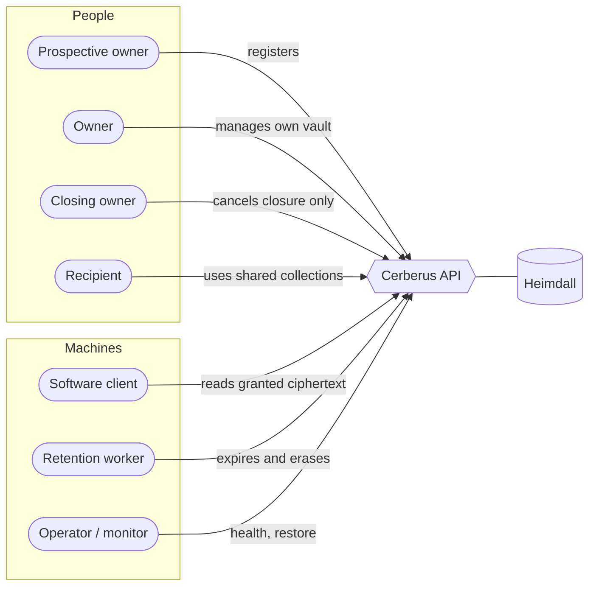

+++
title = 'Introduction'
linkTitle = 'Introduction'
weight = 10
description = 'What Cerberus is, who it is for, what it does and — just as important — what it does not do.'
+++

Cerberus is a self-hosted, end-to-end encrypted vault. It stores passwords, login credentials,
notes and any other sensitive record as **named records of typed fields**, organizes them in
folders, collections and profiles, shares selected collections with other people and serves
selected secrets to software — all without the server ever being able to read them.

The project takes inspiration from Bitwarden and AWS Secrets Manager, but neither is a parity
checklist. Its first user is the project owner, as the beta user, and every approved capability is
part of the first release: there is no smaller feature subset.

## The core idea

Cerberus separates three concerns:

| Concern | Owner |
| --- | --- |
| **Who you are** — sign-in, second factor, identities | Heimdall |
| **What you may touch** — ownership, grants, lifecycle, retention | Cerberus API |
| **What it says** — keys, encryption, decryption, plaintext | The client, on your device |

The API never holds plaintext or a usable decryption key. A database dump, a backup, or a server
holding the identity credentials and the lease-signing key must still not be able to decrypt a
vault.

## Capabilities

| Area | What you get |
| --- | --- |
| **Accounts and protection** | A Cerberus account per user, linked to exactly one Heimdall identity. A master vault password, or a distinct password per profile. A one-time, refreshable recovery key. Vault unlock is always separate from sign-in. |
| **Organized vault** | Records with a required name and **text, numeric, boolean** or **hidden text** fields, blank or from a password, login or note template. Nested folders, account-owned collections and multiple profiles; a device can be restricted to a single profile. |
| **Sharing** | Collections shared **read-only** or **read/write**, after verifying the recipient's key fingerprint. Software identities granted read access to selected records or collections. |
| **Offline** | Desktop and Android keep only ciphertext and work offline. An offline authorization renews every 24 hours by default — changeable or disabled. Latest-edit-wins synchronization, with revocations applied first. |
| **Deletion and privacy** | A 30-day trash and immediate purge. Account closure with 30 days to change your mind, or immediate deletion. A privacy export; LGPD and GDPR controls. |
| **Operations** | Explicit configuration with no production defaults. Liveness, readiness and detailed health. A retention worker and a documented restore runbook. |

## What Cerberus does not do

- **The server never decrypts**, and Cerberus does not replace Heimdall.
- **No other runtime service** besides Heimdall (PostgreSQL is infrastructure).
- **No promise of immediate remote revocation** on a disconnected device: it learns of a
  revocation when it reconnects.
- **No retraction** of plaintext or keys a client has already copied.
- **A shared collection never exposes unrelated data**, and sharing never transfers ownership.
- The client **does not run on iOS or macOS**, stores **nothing in the browser**, writes
  **plaintext nowhere** — not to disk, a log, a preference or a screenshot — and talks to
  **nothing but the Cerberus API**: no analytics, no telemetry, no crash reporter.
- The client **does not invent cryptography**: it implements the reviewed Cerberus protocol, and
  every flow that depends on it waits for that review.

## Actors

| Actor | Who |
| --- | --- |
| **Prospective owner** | Someone registering, or linking a proven Heimdall identity. |
| **Owner** | Acts on their own account and resources, through vault access. |
| **Closing owner** | A freshly authenticated identity limited to the closure-cancellation paths. |
| **Recipient** | Holds an active read-only or read/write grant on someone else's collection. |
| **Software client** | A Heimdall non-human (application) identity with an explicit, read-only secret grant. |
| **Heimdall** | The external identity service, including constrained registration and challenge handling. |
| **Retention worker** | The internal system actor that runs idempotent expiry and erasure. |
| **Operator / monitor** | Uses the public minimal health probes; detailed health needs an operational grant. |

### Roles and what they can do

| Role | Can |
| --- | --- |
| **Owner** | Create, edit, delete, organize and delegate their own resources. |
| **Read-only recipient** | Read the effective members of the shared collection. |
| **Read/write recipient** | Read and edit existing effective members — no deletion, membership or sharing administration. |
| **Software** | Retrieve granted ciphertext and client-wrapped keys. |
| **Operator** | Health, deployment and retention operations — never a usable vault key. |
