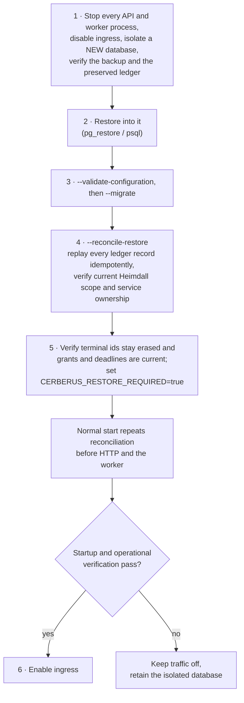

+++
title = 'Backup and restore'
linkTitle = 'Backup and restore'
weight = 30
description = 'Backups, the erasure ledger, and the runbook that restores an instance without resurrecting deleted data.'
+++

A backup taken before a deletion still contains the deleted data. Cerberus makes sure a restore
never brings it back: every completed erasure is also recorded in an **erasure ledger** kept
**outside** the database, and a restored instance replays that ledger before it accepts traffic.

## Backups

- Take them with `pg_dump` or a physical PostgreSQL backup, into `CERBERUS_BACKUP_PATH`.
- Encrypt them independently of client keys — they contain only ciphertext, but they are still
  sensitive metadata.
- Keep them for `CERBERUS_BACKUP_RETENTION`; there is no unlimited default.

## The erasure ledger

The ledger directory, `CERBERUS_ERASURE_LEDGER_PATH`, holds one file per completed erasure
(`kind-GUID.json`), containing only the resource id, its kind and the deletion time.

| Requirement | Why |
| --- | --- |
| Provisioned in advance — the API never creates it | A missing ledger is an error, not an empty one. |
| Mode `0700`, owned by the service user | Only the API may write it. |
| Never a symlink | It cannot be redirected. |
| Not inside the backup path | It must survive the loss of the backups. |
| Never replaced by an older copy | An older copy would forget erasures. |

## Restore runbook

Only an authorized operator restores, and never against the live database.



Any non-zero exit keeps ingress disabled. Record the operator, the backup identity and the result
codes — never protected payloads. Keep `CERBERUS_RESTORE_REQUIRED=true` on restored instances: the
gate is held in memory, so every start reconciles again.

```bash
dotnet ArturRios.Cerberus.WebApi.dll --validate-configuration
dotnet ArturRios.Cerberus.WebApi.dll --migrate
dotnet ArturRios.Cerberus.WebApi.dll --reconcile-restore
```

While `CERBERUS_RESTORE_REQUIRED=true` and reconciliation has not passed, every route except health
answers `503 restore_reconciliation_required`, and the retention worker does not run. A failed
reconciliation prints `restore_reconciliation_required` and exits.
