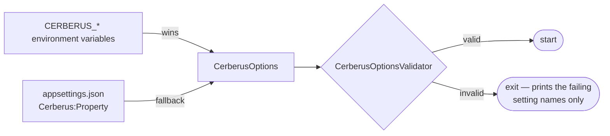

+++
title = 'Configuration'
linkTitle = 'Configuration'
weight = 10
description = 'All Cerberus API settings — required and optional — and the Cerberus UI build settings.'
+++

## How settings are read

Every API setting is read as the environment variable `CERBERUS_<NAME>` first, falling back to
`Cerberus:<Property>` in `appsettings.json`. **Environment variables win.** Keep nonsecret values in
`appsettings.json` (see `docs/operations/appsettings.example.json`) and supply credentials through
protected configuration.



Run `--validate-configuration` to check a configuration without starting the API.

## Required settings

| Setting | Rule |
| --- | --- |
| `CERBERUS_DATA_DATABASETYPE` | Must be `PostgreSql`. |
| `CERBERUS_DATA_CONNECTIONSTRING` | The PostgreSQL connection string. |
| `CERBERUS_HEIMDALL_BASE_URL` | HTTPS, no user info. Loopback HTTP is allowed only outside production. |
| `CERBERUS_HEIMDALL_SCOPE_ID` | The GUID of the Heimdall scope Cerberus uses. |
| `CERBERUS_HEIMDALL_SERVICE_CREDENTIAL` | The narrow scope-owner service credential (registration, readiness, restore checks). |
| `CERBERUS_AUTH_ISSUER` | Expected issuer of Heimdall tokens. |
| `CERBERUS_AUTH_AUDIENCE` | Expected audience of person tokens. |
| `CERBERUS_AUTH_APPLICATION_AUDIENCE` | Expected audience of application tokens. **Must differ** from the person audience. |
| `CERBERUS_AUTH_VALIDATION_SECRET` | The HS256 token-validation secret. At least 32 printable ASCII characters. |
| `CERBERUS_REGISTRATION_FINGERPRINT_KEY` | HMAC key for registration retries. At least 32 printable ASCII characters, different from the auth secrets. Keep it durable across replicas, restores and signing-key rotation. |
| `CERBERUS_BACKUP_RETENTION` | How long backups are kept. TimeSpan, positive. |
| `CERBERUS_LOG_RETENTION` | How long logs are kept. TimeSpan, positive. |
| `CERBERUS_SYNC_RETENTION` | Lifetime of a synchronization stream. TimeSpan, positive. |
| `CERBERUS_RETENTION_INTERVAL` | How often the retention worker runs. TimeSpan, between 1 ms and 4 294 967 294 ms. |
| `CERBERUS_BACKUP_PATH` | Fully qualified backup directory. |
| `CERBERUS_ERASURE_LEDGER_PATH` | Fully qualified erasure-ledger directory, **not** inside the backup path. |
| `CERBERUS_MAX_REQUEST_BYTES` | Maximum request body size, > 0. Larger requests get an empty `413`. |
| `CERBERUS_MAX_PAGE_SIZE` | Maximum page size for list and sync endpoints, > 0. |

TimeSpans use the invariant `c` format: `d.hh:mm:ss`, e.g. `7.00:00:00` or `00:05:00`.

## Optional settings

| Setting | Effect |
| --- | --- |
| `CERBERUS_AUTH_VALIDATION_SECRET_PREVIOUS` | The previous validation secret, accepted during a key rotation. |
| `CERBERUS_OFFLINE_LEASE_ISSUER` and `CERBERUS_OFFLINE_LEASE_PRIVATE_KEY_PEM` | The issuer and P-256 private key that sign offline leases. **Both or neither**: without them, `POST /api/offline-authorizations` answers `503`. |
| `CERBERUS_OPERATIONAL_PERSON_IDS` | Comma-separated canonical UUIDs of persons allowed to read `/health/details`. Empty means nobody. |
| `CERBERUS_OPERATIONAL_APPLICATION_IDS` | The same, for application identities. |
| `CERBERUS_RESTORE_REQUIRED` | `true` on an instance restored from backup: traffic is refused until reconciliation passes. Absent means `false`; an invalid value fails validation. |

## Example values

The approved beta inputs (not defaults):

```json
{
  "Cerberus": {
    "BackupRetention": "7.00:00:00",
    "LogRetention": "7.00:00:00",
    "SyncRetention": "30.00:00:00",
    "RetentionInterval": "00:05:00",
    "BackupPath": "/srv/cerberus/backups",
    "ErasureLedgerPath": "/srv/cerberus-erasure-ledger",
    "MaxRequestBytes": 1048576,
    "MaxPageSize": 100
  }
}
```

## Fixed rules

These are not configurable:

| Rule | Value |
| --- | --- |
| Trash and closure windows | 720 hours (30 days), checked against database time |
| Proof challenge validity | 60 seconds, single use |
| Fresh authentication | A token signed less than 60 seconds ago |
| Initial offline renewal | 24 hours, enabled (changeable per account) |
| Heimdall response bound | 10 seconds for the whole response; no redirects |
| Readiness probe budget | 5 seconds per component |

## Client settings

The Cerberus UI is configured at **build time**:

| Setting | Where | Effect |
| --- | --- | --- |
| `CERBERUS_API_BASE_URL` | `--dart-define` or the Docker build argument | The API instance. Empty: the app starts at `/setup`. Public — never a secret. |
| Build mode | `flutter build` / `flutter run` | Plain HTTP only in debug builds. |

User choices — instance override, storage mode, device profile, theme, auto-lock (default 5
minutes) and clipboard clearing (default 30 seconds) — are preferences on native targets and
memory on the web. The local, homologation and production environments differ only in the API
address and the build mode; no code branches on the environment.
