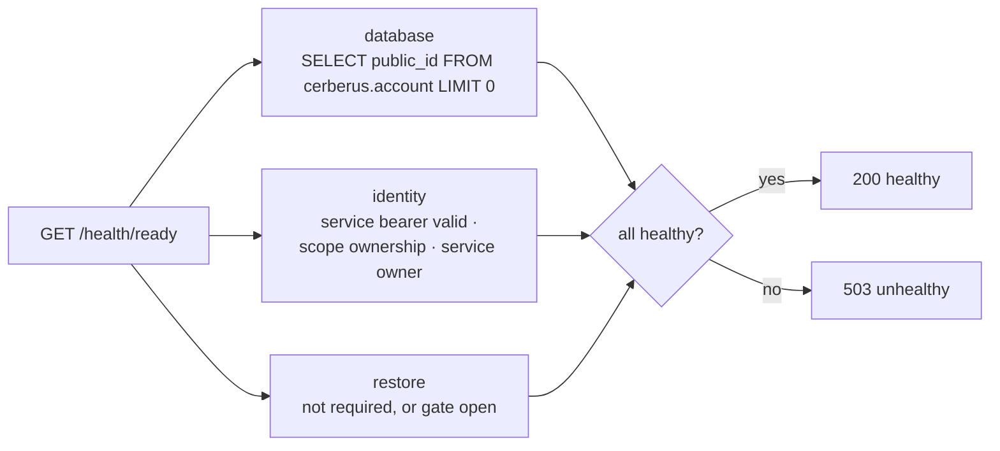

+++
title = 'Health'
linkTitle = 'Health'
weight = 20
description = 'The liveness, readiness and detailed health probes of the API, and the client container probe.'
+++

| Probe | Access | Checks | Answers |
| --- | --- | --- | --- |
| `GET /health/live` | Public | Nothing — the process can answer. | `200 {"status":"healthy"}` |
| `GET /health/ready` | Public | Database, identity and restore. | `200 {"status":"healthy"}` or `503 {"status":"unhealthy"}` |
| `GET /health/details` | Operational grant | The same components, with timings. | Components with `name`, `status`, `elapsedMilliseconds` |

The public probes return only a status: tokens, query parameters and headers cannot opt into
diagnostics, and nothing is cached (`no-store`, no `304`). Health routes are the only routes that
bypass a closed restore barrier.

## Readiness components

- **database** — the configured connection can run the query: the schema and column exist and
  `SELECT` is allowed. No row is fetched or changed.
- **identity** — the non-user service bearer is valid and Heimdall confirms the configured scope
  and the service owner's current role and ownership.
- **restore** — restore is not required, or reconciliation has opened the traffic gate.

Database and identity run independently, each with a five-second cooperative budget. No probe is
cached, retried or scheduled.

## Detailed health

`/health/details` needs a Heimdall identity listed in `CERBERUS_OPERATIONAL_PERSON_IDS` or
`CERBERUS_OPERATIONAL_APPLICATION_IDS`.

| Response | Meaning |
| --- | --- |
| `401 authentication_required` | No valid token. |
| `403 operational_access_required` | The identity is not an operator. |
| `503 identity_unavailable` | Heimdall could not confirm the identity. |

## Retention metrics

The retention worker publishes the meter `ArturRios.Cerberus.Retention` with counters
`cerberus.retention.completed`, `cerberus.retention.failures`, `cerberus.retention.scheduled` and
`cerberus.retention.expired_streams`.

## Client container

The Cerberus UI web image answers `GET /healthz` with `200 ok` (unlogged, `no-store`), and its
Docker `HEALTHCHECK` polls it every 30 seconds.
