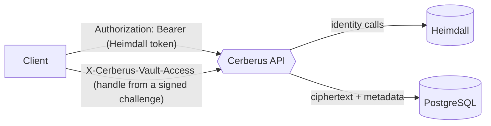

+++
title = 'REST API'
linkTitle = 'REST API'
weight = 10
description = 'Every Cerberus API endpoint, grouped by area, with the interactive OpenAPI reference.'
+++

The Cerberus API publishes an OpenAPI 3.0 contract, `docs/contracts/openapi.json` in the
[cerberus-api](https://git.techcraftsmen.net/artur-rios/cerberus-api) repository. CI checks that
the running application still produces exactly that contract, and the Flutter client generates its
HTTP client from it (see [Client architecture](/docs/architecture/client/)). This site carries a
copy, rendered at the bottom of this page.

{}
The copy here is taken from the API repository when the documentation is updated. When the two
disagree, the contract in the API repository is the source of truth.
{}

## Two kinds of authorization

The contract describes itself in one sentence: *identity authentication and vault access are
separate*. Signing in through Heimdall yields a bearer token that proves **who** the caller is; it
opens nothing. Reading or changing vault content additionally needs a short-lived **vault access**
proof that only a client holding the vault keys can produce. See
[Authentication and vault access](/docs/flows/authentication/).

| Header | Carries |
| --- | --- |
| `Authorization: Bearer …` | The Heimdall token — a person's, or an application's for `GET /api/software-secrets` only. |
| `X-Cerberus-Vault-Access` | The vault-access handle, on every request that reads or changes vault content. |
| `X-Cerberus-Challenge-Id`, `X-Cerberus-Proof` | A signed challenge, on proof operations (unlock, profile access, protection change, recovery). |

The contract itself declares no security schemes, so the generated reference below does not show
these headers. Responses, status codes and error codes are described in
[Responses and errors](/docs/reference/responses-and-errors/); the use case behind each endpoint is
listed in [Use cases](/docs/reference/use-cases/).

## Endpoints by area

### Authentication — `Auth`

| Method | Path | Purpose |
| --- | --- | --- |
| `POST` | `/api/auth/login` | Sign in through Heimdall. |
| `POST` | `/api/auth/2fa/verify` | Complete a second-factor challenge. |
| `POST` | `/api/auth/closure/login` | Sign in to an account that is pending closure (to cancel it). |
| `POST` | `/api/auth/closure/2fa/verify` | Second factor for the closure sign-in. |

### Account — `Account`, `AccountExport`, `Identity`

| Method | Path | Purpose |
| --- | --- | --- |
| `POST` | `/api/accounts` | Register a Cerberus account. |
| `GET` | `/api/accounts/me` | Get the signed-in account. |
| `PUT` | `/api/accounts/me` | Update the account. |
| `PUT` | `/api/identity/me` | Update identity details held by Heimdall. |
| `GET` | `/api/accounts/me/offline-policy` | Read the offline renewal policy. |
| `PUT` | `/api/accounts/me/offline-policy` | Change or disable the offline renewal policy. |
| `POST` | `/api/accounts/me/closure` | Request account closure (30-day grace period). |
| `POST` | `/api/accounts/me/closure/cancel` | Cancel a pending closure. |
| `DELETE` | `/api/accounts/me/permanent` | Permanently delete the account now. |
| `POST` | `/api/accounts/me/export` | Export the account's data. |

### Vault protection — `Vault`

| Method | Path | Purpose |
| --- | --- | --- |
| `GET` | `/api/vault/protection` | Read the vault protection material. |
| `POST` | `/api/vault/protection` | Initialize vault protection. |
| `PUT` | `/api/vault/protection` | Change vault protection. |
| `POST` | `/api/vault/challenges` | Issue a vault-access challenge. |
| `POST` | `/api/vault/unlock` | Prove vault access and receive an account-wide vault-access handle. |
| `GET` | `/api/vault/recovery-material` | Read the material needed to recover with the recovery key. |
| `POST` | `/api/vault/recovery` | Recover vault access with the one-time recovery key. |
| `PUT` | `/api/vault/recovery` | Refresh (replace) the recovery key. |

### Profiles — `Profiles`

| Method | Path | Purpose |
| --- | --- | --- |
| `GET` | `/api/profiles` | List profiles. |
| `POST` | `/api/profiles` | Create a profile. |
| `GET` | `/api/profiles/{id}` | Get a profile. |
| `PUT` | `/api/profiles/{id}` | Update a profile. |
| `DELETE` | `/api/profiles/{id}` | Move a profile to the trash (its records, folders and collections are kept). |
| `PUT` | `/api/profiles/{id}/associations` | Set which folders, records and collections the profile contains. |
| `POST` | `/api/profiles/{id}/access/challenges` | Issue a profile-access challenge. |
| `POST` | `/api/profiles/{id}/access` | Open profile access with a proof; returns a profile-scoped handle. |

### Records — `Records`

| Method | Path | Purpose |
| --- | --- | --- |
| `GET` | `/api/records` | List records. |
| `POST` | `/api/records` | Create a record. |
| `GET` | `/api/records/{id}` | Get a record. |
| `PUT` | `/api/records/{id}` | Update a record. |
| `DELETE` | `/api/records/{id}` | Move a record to the trash. |
| `DELETE` | `/api/records/{id}/permanent` | Permanently delete a record. |
| `PUT` | `/api/records/{id}/folder` | Move a record to another folder. |

### Folders — `Folders`

| Method | Path | Purpose |
| --- | --- | --- |
| `GET` | `/api/folders` | List folders. |
| `POST` | `/api/folders` | Create a folder. |
| `GET` | `/api/folders/{id}` | Get a folder. |
| `PUT` | `/api/folders/{id}` | Update a folder. |
| `DELETE` | `/api/folders/{id}` | Move a folder to the trash, with its subfolders and records. |
| `PUT` | `/api/folders/{id}/parent` | Move a folder under another parent. |

### Collections and sharing — `Collections`

| Method | Path | Purpose |
| --- | --- | --- |
| `GET` | `/api/collections` | List collections. |
| `POST` | `/api/collections` | Create a collection. |
| `GET` | `/api/collections/{id}` | Get a collection. |
| `PUT` | `/api/collections/{id}` | Update a collection. |
| `DELETE` | `/api/collections/{id}` | Move a collection to the trash and revoke its grants (members are kept). |
| `PUT` | `/api/collections/{id}/members` | Set the collection's member records and folders. |
| `POST` | `/api/collections/{id}/grants` | Share the collection with another account, or regrant a revoked share. |
| `PUT` | `/api/collections/{id}/grants/{grantId}` | Change a share's access level. |
| `DELETE` | `/api/collections/{id}/grants/{grantId}` | Revoke a share. |

### Software access — `SoftwareGrants`, `SoftwareSecrets`

| Method | Path | Purpose |
| --- | --- | --- |
| `POST` | `/api/software-grants` | Grant a software identity read access to selected secrets. |
| `DELETE` | `/api/software-grants/{id}` | Revoke a software grant. |
| `GET` | `/api/software-secrets` | Retrieve the ciphertext granted to the calling software. |

### Offline and synchronization — `OfflineAuthorizations`, `Sync`

| Method | Path | Purpose |
| --- | --- | --- |
| `POST` | `/api/offline-authorizations` | Issue or renew the offline lease for a profile. |
| `GET` | `/api/sync/changes` | Download changes since a cursor. |
| `POST` | `/api/sync/edits` | Upload edits made offline. |

### Trash — `Trash`

| Method | Path | Purpose |
| --- | --- | --- |
| `GET` | `/api/trash` | List recoverable trash entries. |
| `POST` | `/api/trash/{id}/restore` | Restore a trash entry. |
| `DELETE` | `/api/trash` | Permanently empty the trash. |

### Health — `Health`

| Method | Path | Purpose |
| --- | --- | --- |
| `GET` | `/health/live` | Liveness probe. |
| `GET` | `/health/ready` | Readiness probe. |
| `GET` | `/health/details` | Detailed health, for operators holding an operational grant. |

See [Health probes](/docs/operations/health/) for what each probe reports.

## Interactive reference


