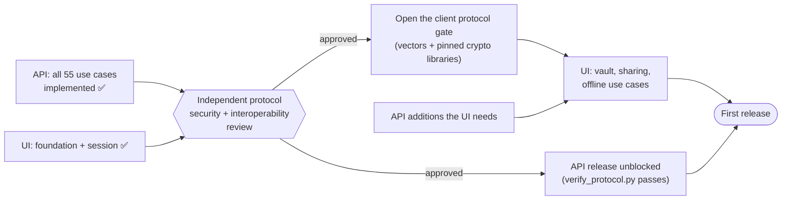
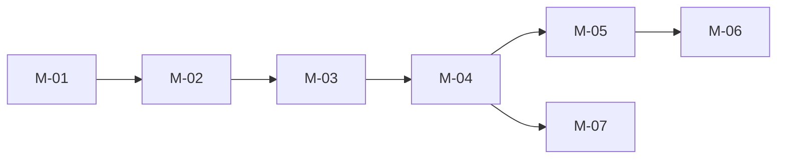

+++
title = 'Roadmap'
linkTitle = 'Roadmap'
weight = 40
description = 'Milestones of both applications, where each stands, and what blocks the rest.'
+++

{}
The status below was taken from each repository's README when this site was written. The project
boards are the live view: [Cerberus API](https://github.com/users/artur-rios/projects/15) ·
[Cerberus UI](https://github.com/users/artur-rios/projects/16).
{}

## The critical path

## API milestones

| Milestone | Delivers | Depends on | Progress |
| --- | --- | --- | --- |
| M-01 — Foundation | Scaffold, persistence, identity adapters, tests, CI, safe operational primitives | — | 1 / 1 |
| M-02 — Account identity and vault protection | Register, sign in, manage account details, protect and recover the vault | M-01 | 9 / 9 |
| M-03 — Organized vault | Profiles, records, nested folders, collection membership | M-01 – M-02 | 26 / 26 |
| M-04 — Controlled sharing and software secrets | Share collections, serve granted software ciphertext | M-01 – M-03 | 6 / 6 |
| M-05 — Offline synchronization | Configurable renewal, incremental access changes, deterministic offline edits | M-01 – M-04 | 5 / 5 |
| M-06 — Recoverable deletion and beta operations | Closure and erasure, trash restore and expiry, privacy export, health | M-01 – M-05 | 9 / 9 |

## Client milestones

| Milestone | Delivers | Depends on | Progress |
| --- | --- | --- | --- |
| M-01 — Foundation | Scaffold, storage per target, crypto boundary and protocol gate, generation pipeline, leak recorder, CI | — | 1 / 1 |
| M-02 — Access and session | Instance setup, registration, sign-in with second factor, session restore, sign-out, route guard, identity details, preferences | M-01 | 6 / 9 |
| M-03 — Vault protection | Client-side encryption, protection, unlock and lock, protection changes, recovery and refresh, encrypted account details | M-01 – M-02 | 0 / 8 |
| M-04 — Organized vault | Profiles and device restriction, typed records and templates, reveal and copy, folders, collections | M-01 – M-03 | 0 / 14 |
| M-05 — Sharing and software access | Verified sharing, changing and revoking shares, shared collections, software grants | M-01 – M-04 | 0 / 5 |
| M-06 — Offline use and synchronization | Storage modes, offline policy and lease, ciphertext store, offline edits, sync | M-01 – M-05 | 0 / 6 |
| M-07 — Recoverable deletion and data rights | Trash, closure and cancellation, immediate deletion, export | M-01 – M-04 | 0 / 6 |

## What the client needs from the API

| Needed from the API | Blocks client use cases |
| --- | --- |
| Approval of the Cerberus protocol after its security and interoperability review | UC-08, UC-11 … UC-36, UC-39 … UC-43, UC-48 — everything that encrypts, decrypts, wraps or proves |
| Challenge issuance for vault-access proofs *(now in the API contract as `POST /api/vault/challenges`; the client's copy of the contract and UC-13's text are still to catch up)* | UC-13 |
| Looking up a recipient's public key and fingerprint | UC-32 |
| A software identity's public key | UC-35 |
| Listing a collection's grants | UC-30, UC-33 |
| Listing the account's software grants | UC-36 |
| Publication of the offline lease verification keys | UC-39 |
| A distinct report that an account is pending closure, at sign-in and on session restore | UC-46 (and its offer from UC-03 and UC-05) |
| A distinct report that a second-factor challenge has expired, apart from a refused code | UC-04 (its return to sign-in) |

Today, an account pending closure gets `authentication_required` from `POST /api/auth/login`, and
`POST /api/auth/2fa/verify` answers `authentication_required` both for a wrong code and for an
invalid challenge.

{}
The client generates its HTTP client from its own copy of the API contract, taken deliberately in
the change that needs it. That copy currently covers the account, authentication, identity and
vault endpoints; it is refreshed as client use cases need more.
{}
